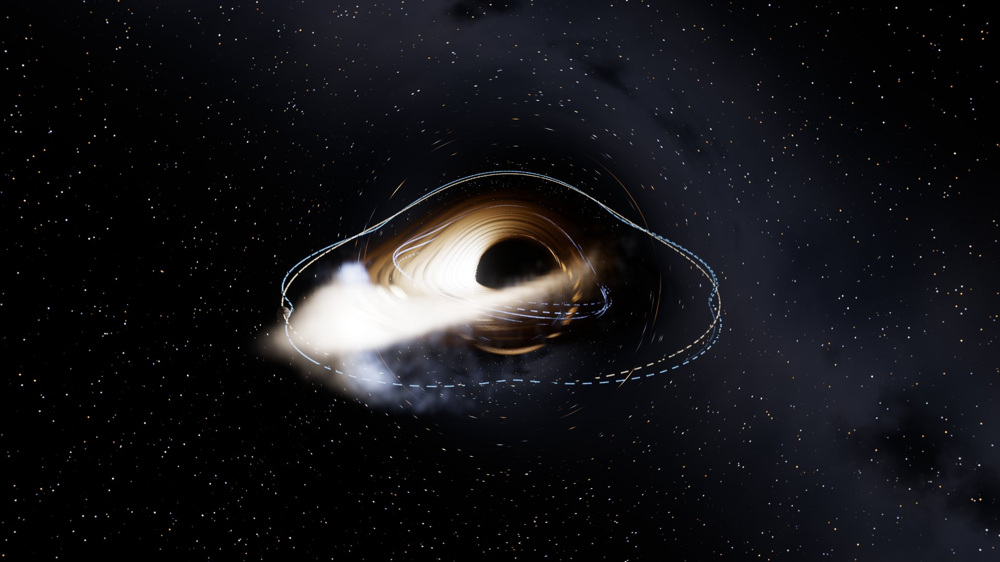

# Black Hole Simulator

A real-time simulator of a **rotating (Kerr) black hole**, and of the other things that can
sit at the center: **neutron stars** (pulsars, magnetars), **white dwarfs**, **stars** (the
Sun, red dwarfs, brown dwarfs, red giants) and **planets**. Written in C++20 and OpenGL 4.6.
Every pixel is ray traced through curved spacetime on the GPU, and everything in the scene
is lensed, Doppler-shifted and redshifted by the same physics: stars, planets, pulsars,
torn-apart stars, glowing gas, jets, even the orbit lines you draw. You can fly the camera
straight through the event horizon, or land on a neutron star.



## What you can do

- **Choose what sits at the center:** a black hole, a neutron star, a pulsar, a magnetar,
  a white dwarf (or Sirius B), the Sun, a red dwarf, a brown dwarf, a red giant, Jupiter or
  the Earth, each one click away with its real mass, radius, spin and temperature. For the
  same mass, **orbits and light bending outside the surface are identical** for all of them
  (Birkhoff's theorem): only how close you can get changes.
- **Squeeze a star:** the compactness slider keeps the mass and shrinks the radius. Watch
  the Sun turn into something as dense as a white dwarf, then a neutron star: light starts
  to bend round it until you see its back, its surface reddens, the disk stops at the ISCO,
  the photon ring appears below R = 3M, and below the Buchdahl limit (9/4 M) it collapses
  into a black hole with the same mass and spin. A white dwarf pushed over 1.44 solar masses
  collapses into a neutron star; a neutron star over ~1.64 into a black hole.
- **Surfaces:** blackbody light seen at g T with limb darkening, granulation, sunspots and a
  faint corona on stars, hot magnetic polar caps on neutron stars (with sweeping pulsar
  beams), flaring magnetars, sunlit planets with atmospheres. Anything that strikes a
  surface leaves a glowing hot spot, and gas piling up on a neutron star or white dwarf goes
  off in **X-ray bursts** and **novae**. A magnetized star holds its disk off at the Alfven
  radius and feeds **accretion curtains** that run along its field lines to its poles.
- **Land on it:** drop the camera onto a star or planet; it reports your impact speed, the
  surface gravity and how fast clocks run there. Live readouts show the surface redshift,
  surface gravity, escape speed, how much of the surface you see at once, and how much of
  the infalling rest mass the disk and the surface release (5.7% for a black hole without
  spin, 19% for a neutron star).
- **Physical units:** give the mass and every readout also shows km, AU, seconds or hours.
  With a black hole, the tidal disruption preset then uses a Sun at its true size: Sgr A*
  tears it apart at 18 M; M87*, above the Hills mass, swallows it whole.
- **Small black holes** among the bodies lens whatever lies behind them and swallow what
  strays too close.
- **Look at a black hole:** the shadow, the photon ring, and an accretion disk whose far
  side is lensed over the top. Light from the approaching side is boosted and bluer.
  Famous holes are one click away: **M87\***, **Sagittarius A\***, **Gargantua**
  (Interstellar) and **Cygnus X-1**.
- **Fall in:** drop the camera, or ride a plunging star, and cross the event horizon.
  Nothing marks the moment; inside, the outside universe shrinks to a patch above you and
  blueshifts as you approach the inner horizon, where the ride ends. Time slows down
  automatically near the hole so you can watch it.
- **Throw things at it:** stars, rocky planets and gas giants lit by the disk, and
  **pulsars**, whose beams flash as they sweep past you. Each one follows an exact Kerr
  orbit. Presets demonstrate precession, zoom-whirl orbits, frame dragging, plunges and
  flybys.
- **Gravity between bodies:** heavy bodies pull on each other and on gas. A **binary star**
  falling toward the hole is pulled apart: one star is captured on a tight orbit and the
  other flung out at a fifth of the speed of light (the Hills mechanism). A **planet with a
  moon** keeps it inside its Hill sphere while both race around the hole at 0.2c.
- **Spaghettification:** a star's shape follows the tides (the affine star model): it is
  drawn into an egg on the way in, squeezed at closest approach, then stretched without
  limit into a stream of 150,000 parcels of gas. A **grazing star** that passes just outside
  its tidal radius survives, wobbling.
- **Gas with real physics:** the debris has pressure; where its streams cross they shock,
  heat up and glow blue-white, then radiate the heat away. Squeezed gas heats, expanding gas
  cools. There is also a **gas cloud** that is sheared into a noodle, and a **tilted ring**
  that frame dragging slowly twists.
- **Plan a launch:** set a position, velocity and mass, or just drag on the orbit map. You
  immediately get the exact verdict (*falls in*, *bound between r₁ and r₂*, *escapes*,
  *circular*), a live **effective-potential graph** showing why, and, with heavy bodies
  around, what actually happens once their pull is included.
- **See orbits in space:** trails and predicted paths are drawn into the scene as thin
  glowing lines. They are ray traced too, so a path behind the hole appears bent over it.
- **Ride along:** orbit the hole, free-fall toward it, or sit on any body. A moving camera
  sees **relativistic aberration**: the sky crowds forward and turns blue.
- **Inspect a pixel:** Ctrl+click anywhere to trace the light that reached it: its source,
  its frequency shift, how many times it circled the hole, and its travel time.
- **Light-travel delay, everywhere:** bodies, gas, the disk's pattern and the jets' knots
  are all drawn as they were when their light left them. Lensed images of a pulsar flash
  out of step; a ring of gas that has just formed is seen only partly, because light from
  its far side has not arrived yet; a torn-apart star is still seen whole until the light
  of its destruction reaches you.
- **Relativistic jets** with knots that appear to move faster than light: the jet coming
  toward you blazes and the counter-jet all but vanishes.
- **Record videos** (MP4, up to 4K, 60 fps) with Windows' built-in encoder.

## Building

Requirements: Windows, Visual Studio 2026 with the *Desktop development with C++*
workload (it includes CMake), and a GPU with OpenGL 4.6.

```powershell
.\build.ps1          # configure, build Release, run the physics tests
.\build.ps1 -Run     # ...and start the simulator
```

`build.ps1` uses Visual Studio 2026, or Visual Studio 2022 when 2026 is not installed. The
first configure downloads GLFW, GLM, Dear ImGui and stb (pinned versions), which
takes a couple of minutes. The executable is `build\Release\blackhole.exe`. Edits to
`shaders\` reload while it runs.

## Controls

| Input | Action |
|---|---|
| Left drag | Orbit the camera around the hole (look around while moving) |
| Right drag | Look around |
| Scroll, W / S | Move closer / farther |
| A / D, Q / E | Orbit sideways / up and down |
| Ctrl+click or middle-click | Inspect the light reaching that pixel |
| Drag on the orbit map | Aim a launch (with the launch planner open) |
| Enter | Launch the planned body |
| Space | Pause or resume |
| R | Reset the camera |
| G | Toggle the lensing grid |
| Tab | Hide or show the interface |
| F12 | Save a screenshot to `screenshots\` |
| Esc | Stop recording |
| H | Show the controls |

### Things to try

- **Camera → Free fall** from the default view: watch the shadow swell, then cross the
  horizon. Or add **Plunge**, ride it (*Ride along*), and turn on *Look where you're going*.
- **Objects → Tidal disruption**, time scale ~40: the star stretches, tears apart near
  closest approach, and its debris wraps around the hole and shocks where it crosses.
- **Binary star**: follow the two paths; after the pair passes the hole, one star's
  energy E is below 1 (captured) and the other's above 1 (escaping).
- **Launch planner** with a **Planet with moon** present: give the launch a mass of 0.01
  and throw it near the planet; the second verdict line shows what the planet's pull does.
- **Polar orbit** at spin 0.99 with *Paths in view*: frame dragging swings the orbital
  plane around the axis, drawing a cage of loops.
- **Pulsar** plus *Light travel time*: its lensed images near the shadow flash out of step
  with the direct image.
- **Famous black holes → M87\*:** a one-sided jet nearly toward you.
- **Central object → Sun**, then drag **Compactness M/R** to the right: the Sun becomes as
  dense as a white dwarf, then a neutron star, until it collapses into a black hole.
- **Central object → Neutron star**, **Camera → Free fall**: you land at about 0.55c, and
  the horizon around you is lifted by light bending.
- **Central object → Pulsar** seen from 70 degrees: the disk stops at the magnetosphere and
  the gas falls along the field onto the poles.
- **Objects → Small black hole**, with *Light travel time* off to line it up: it lenses the
  disk behind it.

## Command line

```text
blackhole [options]
  center   --central earth|jupiter|brown-dwarf|red-dwarf|sun|red-giant|white-dwarf|sirius-b|
                     neutron-star|pulsar|magnetar|stellar-black-hole|sgr-a|m87
           --mass MSUN  --radius-km KM  --compactness R/M  --temperature K  --field GAUSS
           --physical-units
  scene    --scene default|m87|sgra|gargantua|cygnus   --spin A   --jets   --no-disk
           --disk-temp K  --disk-brightness B  --relativity full|beaming|off  --no-light-delay
           --sky stars|grid|image|black   --sky-image PATH
  objects  --preset NAME (repeatable):
             isco circular retrograde precessing zoom-whirl polar plunge flyby cluster
             planet gas-giant pulsar tde grazing binary moon cloud ring einstein-ring
             mini-hole white-dwarf
           --advance T          simulate T M first
           --no-gravity  --no-gas-physics  --gas-collisions K  --gas-cooling T
           --debris-glow B  --debris-thickness K  --no-paths
  camera   --distance R  --inclination DEG  --azimuth DEG  --fov DEG
           --camera hover|orbit|fall   --ride N   --look-ahead
  output   --screenshot PATH [--frames N] [--ui] [--size WxH] [--scale S]
           --record PATH [--duration S] [--fps N] [--camera-path flown|orbit|push-in]
  probes   --inspect X,Y   --heatmap   --debug-directions
```

Around a star or planet, distances (`--distance`) and times (`--advance`) are in scene units:
R/6 of length and its dynamical time (see *Scene scale* below). For example, a neutron star
seen from close by, and a 4K video of a tidal disruption seen from orbit:

```powershell
.\build\Release\blackhole.exe --central pulsar --inclination 70 --distance 22
```


```powershell
.\build\Release\blackhole.exe --preset tde --advance 300 --size 3840x2160 --record tde.mp4 --duration 20 --fps 60 --camera-path orbit
```

## How it works

### Units, coordinates, geodesics

Units are G = c = M = 1: lengths in GM/c², times in GM/c³. For Sagittarius A*, 1 M of
time is about 20 seconds. The spacetime is the Kerr metric in **ingoing Kerr-Schild
coordinates**: r and θ are the Boyer-Lindquist ones, while t and φ are shifted along
ingoing light rays, t = t_BL + ∫(r² + a²)/Δ dr − r and φ = φ_BL + ∫a/Δ dr. That removes the
coordinate singularity at the horizon, so bodies, gas, light and the camera all cross it
in finite time. Far away the two agree.

Geodesics have four constants: energy *E*, axial angular momentum *L*, the Carter constant
*Q* and rest mass μ. In Mino time τ (dλ = Σ dτ) the equations separate:

```text
(dr/dτ)² = R(r)  = P² − Δ K,      P = E(r² + a²) − aL,   K = μ²r² + (L − aE)² + Q
(dθ/dτ)² = Θ(θ)  = Q − cos²θ [a²(μ² − E²) + L²/sin²θ]
dφ/dτ    = a F − aE + L/sin²θ
dt/dτ    = (r² + a²) F − a(aE sin²θ − L) − dr/dτ,      F = (P + dr/dτ)/Δ
```

F is 0/0 where an ingoing path crosses the horizon; on the constraint surface it equals
K / (P − dr/dτ), which is smooth there. Everything integrates the second-order form
(d²r/dτ² = R′/2, d²θ/dτ² = Θ′/2) with RK4, which passes through turning points with no
sign bookkeeping. Two numerical details matter:

- **Constraint drift.** The system conserves vr² − R exactly, including its rounding
  error. Since R ~ r⁴, that error becomes fake turning points near the hole, which is fatal
  in 32-bit floats. So velocities are re-projected onto vr² = R and vθ² = Θ away from
  turning points.
- **The spin axis.** φ swings through π as a ray grazes the axis. Steps shrink as sin θ
  does, and rays that would pass within 3×10⁻⁴ rad are sent exactly through it.

### Light (GPU, `shaders/trace.frag`)

**Camera.** The camera carries an orthonormal frame built from its 4-velocity (for a
hovering camera, the frame of the local zero-angular-momentum observer). Each pixel's
direction becomes a photon with unit energy in that frame, which makes aberration and the
camera's own blueshift automatic, and works inside the horizon, where nothing can hover.
Photons are not normalized to E = 1, since inside the ergosphere E can be zero or
negative.

**Ray marching.** Rays are traced backwards with adaptive steps. Along the way each ray
picks up the light-travel delay ∫ dt, and meets, in order:

- **Debris gas:** the parcels are binned into a (log r, θ, φ) grid. A coarse occupancy
  map skips empty space, and the gas emits and absorbs with its own Doppler shift.
- **Jets:** an analytic plasma flow along the axis at speed β. Emission is ∝ g³; the knots
  are placed as they were a light-travel time ago.
- **Path lines:** segments are binned into a grid and tested against each ray chord; a
  small occupancy texture lets most steps skip the test. Lines keep a constant on-screen
  width, and images seen through strongly bent light fade.
- **The disk:** gas on circular orbits with T ∝ [r⁻³(1 − √(r_in/r))]^¼. Its turbulence
  pattern is shown as it was a delay ago.
- **Bodies:** each body is looked up where, and in what shape, it was a delay ago, from a
  history texture; a body that has gone (torn apart, swallowed) is still drawn in light
  that left it earlier. Each ray keeps, per body, a margin it can travel before it could
  possibly reach that body, so distant bodies cost almost nothing.
- **The horizon or the sky.** A ray from outside that sinks back toward the horizon came
  out of the past horizon: the shadow. Inside the horizon every ray, followed back,
  rises to the horizon; one that gets there with E − Ω_H L < 0 entered from the far side of
  the eternal Kerr spacetime and is drawn black.

**Color.** Emitters are blackbodies seen at temperature g·T, where g = 1/(−p·u) for the
photon of unit camera energy. The color comes from a lookup of the Planck spectrum
integrated against the CIE 1931 color-matching functions.

### The central object (`src/central.*`)

Outside any spherical, non-rotating body spacetime is exactly Schwarzschild (Birkhoff's
theorem), so a neutron star, the Sun and a black hole of the same mass have the same orbits
and bend light the same way outside the star. A rotating body gets the Kerr exterior with
its mass and angular momentum, cut off at its surface r = R: exact in M and J, approximate
in the quadrupole (a real neutron star's is 2-10 times the Kerr value, a small effect below
spin ~0.4). Planets and ordinary stars have J/M^2 far above 1 (the Earth ~890); a Kerr
metric with a > 1 is a naked singularity, not a planet's exterior, so the metric uses
a = min(J/M^2, 0.99), whose frame dragging is negligible out at their surfaces anyway.

Every ray, body, parcel of gas and the camera stops at the boundary: the horizon r+ for a
black hole, R for anything else (an orbit's *fate* becomes "hits the surface"). The surface
rotates rigidly, u = u^t (1, 0, 0, Omega) with u^t = [-(g_tt + 2 Omega g_tphi + Omega^2
g_phiphi)]^(-1/2), so the light reaching the camera left it with g = 1 / (u^t (E - Omega L)),
the same form as for disk gas. The emission angle in the surface's own frame,
cos(alpha) = (p . e_r) / (-p . u) = g |v_r| / sqrt(Sigma Delta), sets the limb darkening,
I(mu) / I(1) = (2 + 3 mu) / 5 (Eddington). Surfaces are painted in the rotating frame:
longitude phi_BL - Omega (t - delay), with phi_BL = phi - (Kerr-Schild azimuth shift).

Readouts, for a non-rotating star: 1 + z = (1 - 2M/R)^(-1/2), surface gravity
M / (R^2 sqrt(1 - 2M/R)), escape speed sqrt(2M/R), clock rate sqrt(1 - 2M/R). Light leaving
the surface at angle alpha reaches infinity having swept
psi = integral dr / (r^2 sqrt(1/b^2 - (1 - 2M/r) / r^2)), b = R sin(alpha) / sqrt(1 - 2M/R);
the tangential ray sets how far round the star you can see (122 degrees, 76% of the surface,
for R = 5.8M; all of it below R = 3.52M). Beloborodov's 1 - cos(alpha) = (1 - cos(psi))(1 - 2M/R)
is shown for comparison.

Accretion releases 1 - E_isco onto a black hole. Onto a star, the disk releases 1 - E_in
down to its inner edge max(ISCO, R), and the gas then settles on the surface at rest
(co-rotating), releasing E_in - E_surface more: 1 - sqrt(1 - 2M/R) in all for a non-rotating
star, 19% for a neutron star. A magnetized neutron star or white dwarf stops the disk near
half the Alfven radius, r_A = (mu^4 / (2 G M Mdot^2))^(1/7) with mu = B R^3; inside, gas
follows the dipole field lines r = L sin^2(theta_m) from where they thread the disk's inner
edge to the nearer magnetic pole.

Stellar structure: the Tolman-Oppenheimer-Volkoff equations for a Gamma = 2, K = 100
polytrope give the neutron stars' mass-radius curve (1.40 solar masses at 14.2 km, maximum
1.64); white dwarfs follow Nauenberg's R = 0.0112 R_sun sqrt((M/M_Ch)^(-2/3) - (M/M_Ch)^(2/3)).
A star smaller than the Buchdahl limit, R = 9M/4, or a neutron star over the maximum mass,
collapses to a black hole with the same M and J (a black hole cannot spin faster than a = 1:
a planet's excess spin is shed first, leaving a = 0.998). A white dwarf over 1.44 solar
masses collapses to a neutron star (accretion-induced collapse).

**Scene scale.** The Sun is 471,000 M across, the Earth 1.4e9 M: far beyond what single
precision can trace (R(r) ~ r^4 overflows). So the scene is laid out in units of
s = max(1, R/6) M: 1 for black holes and neutron stars, so every existing scene is
untouched, and R/6 for bigger objects, which then look like neutron-star-sized scenes on
screen. The GPU works in these units, where the metric is Kerr with mass m = 1/s; every
GPU formula carries m (Delta = r^2 - 2mr + a^2, R'/2 = 2ErP - (r - m)K, ...). Disk radii,
preset orbits, camera limits, the time scale (s^1.5, the dynamical time), the light-delay
history and the gas's thermal scale all follow s, so the same demonstrations work around any
object. The compactness slider changes s continuously: the camera stays put in scene units
until R < 6M, then the star shrinks in a fixed frame while its relativistic effects switch on.

**Small black holes** among the bodies (no exact spacetime holds two black holes) bend
light in the thin-lens approximation: a ray passing at impact parameter b turns by 4m/b
toward the small hole, in the local ZAMO frame at fixed local frequency, after which E, L
and Q are recomputed from its new direction; rays passing within 3 sqrt(3) m are captured.
Each small hole bends a given ray once, at its closest approach.

### Matter

**Bodies** (CPU, double precision, `src/bodies.cpp`) integrate in coordinate time and record
a 2048 M history (position, 4-velocity, shape) used for the light-travel delay. New bodies
are integrated backwards to fill in their past.

**Gravity between bodies** (`src/gravity.cpp`): kick, drift, kick. Between kicks each body
follows its exact Kerr geodesic; a kick adds the Newtonian pull of the others to its
4-velocity, measured in the body's own rest frame: each separation runs between events
simultaneous *for that body* and its length comes from the metric. That last point
matters: measuring separations on the coordinate time slices (or in ZAMO frames) gave a
pair moving at 0.2c a steady spurious torque that spun a moon out of its planet's grip
within a few orbits; with the relativity of simultaneity included it stays put.

**Tidal deformation** (`src/tidal.cpp`): the affine star model (Carter & Luminet 1983). A
star is a homogeneous ellipsoid x = F X whose deformation evolves in its proper time under
the hole's tide, its own gravity (index symbols via Carlson's R_D) and its pressure. The
tidal tensor uses the exact Schwarzschild eigenvalues in the star's frame,
(M/r³)[2 + 3K/r², −(1 + 3K/r²), −1], with Carter's K. A uniform star is more fragile than
a real, centrally condensed one, so its dynamical frequency is calibrated to make full
disruption set in at β = r_t/r_p ≈ 0.9, as hydrodynamic simulations of γ = 5/3 stars find.
Once its longest axis passes 2.5 radii it is torn apart, and the debris inherits its shape
and its internal velocity field dF/dτ X.

**Gas** (GPU, `shaders/particles_update.comp`): each parcel follows its own geodesic in
float32 with the same constraint projection. Once a frame it also feels the rest of the
gas through a full-precision grid (a particle-mesh method), as a kick in its local frame:

- *pressure*, P = (γ − 1) ρ u, from the gradient of the gridded ρT;
- *collisions*: parcels relax toward the local mean velocity at a rate ∝ density. Smooth
  flows are untouched; crossing streams lose their relative motion as heat, which is
  what shocks do and what turns tidal debris into a disk;
- *adiabatic heating and cooling*: each parcel carries its entropy T/ρ^(γ−1), so its
  temperature follows the local density without accumulating noise;
- *radiative cooling* at a rate ∝ T³, down to a floor set by the surrounding light;
- the pull of heavy bodies.

With light delay on, each parcel also carries the copy of itself the camera sees, a
light-travel time behind (straight-line distance plus the Shapiro delay), and those copies
are what is drawn.

**Launch verdicts** (`src/trajectory.cpp`) are exact for a test particle. The motion is
confined between the zeros of R(r) around the start: no zero inward means it falls in, and
no zero outward means it escapes. The effective potential V(r) is the root of R(r; E) = 0 in
E. With heavy bodies around, the planner also simulates the launch together with them on a
worker thread.

### Tests (`tests/test_kerr.cpp`)

218 checks against exact results:

- units and the catalogue (1 M of M87* is 64 AU; the Sun is 471,000 M);
- neutron-star surface: 1 + z = 1.2355, surface gravity 0.0367/M = 1.6e12 m/s^2; the Sun's
  redshift (0.636 km/s) and limb deflection (4M/b = 1.751"), against the exact integral;
  Sirius B's 77 km/s;
- light bending at R = 5.8M: the ray tracer's integrator against the exact integral to
  1e-6 rad; Beloborodov's approximation; the whole surface visible below R = 3.52M;
- a radial photon from a static surface arrives with g = sqrt(1 - 2M/R) (to 1e-9), and the
  emission angle formula the GPU uses against the surface element's own frame;
- Birkhoff: the same orbit is bound around a black hole and a 4.5M star, and hits a 5.8M one;
- Mercury's perihelion: 42.98" per century from the exact Schwarzschild formula;
- TOV (1.40 solar masses, 9.586 = 14.2 km; maximum 1.637) and Nauenberg (8,660 km);
- accretion efficiencies (5.72%, 32%, 19.1%), the Alfven radius, the Hills mass (1.14e8),
  tidal radii at Sgr A* (17.8 M) and M87* (swallowed whole);
- collapse rules, the compactness stages, the scene scale, the thin-lens deflection 4m/b
  (in the ray tracer too) and capture inside 3 sqrt(3) m;

- horizon, ISCO and photon-orbit radii, and circular-orbit E and L;
- the Kerr-Schild metric (its known inverse, and flat-plus-null form in the Cartesian
  chart), and the coordinate shifts against Boyer-Lindquist rates;
- free fall through the horizon against the exact cycloid, with finite coordinate time;
- observer frames orthonormal outside and inside the horizon; looking up from inside the
  horizon shows the sky, looking down shows darkness;
- the ray tracer's frequency-shift formula against −p·u, inside the horizon too;
- conservation over thousands of M; the exact Schwarzschild precession; the separatrix;
- the shadow edges for a = 0 and 0.9 to 0.1%; near-axis rays;
- a moving observer's measured energy, and the head-on Doppler factor;
- the tidal model: index symbols (sphere, sum rule, prolate spheroid), equilibrium, the
  relativistic tide on a circular orbit, disruption at β = 2.3 and survival at β = 0.86;
- gravity between bodies: a binary's Kepler period, and a moon of a planet moving at 0.22c
  staying bound;
- the tidal energy spread and ring inclinations of the debris;
- the fate classifier against brute-force integration;
- the radial light-travel time [r + 4 ln(r − 2) in Kerr-Schild time];
- the ray inspector's classification of shadow, sky and disk.

## Project layout

```text
src/kerr.*         Kerr physics: radii, metric, geodesics, observer frames, photons
src/central.*      the central object: catalogue, units, surface physics, light bending,
                   accretion, TOV and white-dwarf structure, collapse
src/trajectory.*   fate classification, path prediction, effective potential, ray inspection
src/tidal.*        the affine model of a tidally deformed star
src/gravity.*      gravity between bodies, joint path prediction
src/debris.*       initial conditions for disrupted stars, clouds and rings
src/bodies.*       orbiting bodies, presets, tidal disruption, light-delay history
src/particles.*    GPU gas: buffers, physics, grids, light-delayed copies
src/renderer.*     ray-trace, bloom and tone-map passes; path-line binning
src/camera.*       hovering, orbiting, falling and riding cameras
src/recorder.*     MP4 encoding with Media Foundation
src/ui.*           control panel, launch planner, orbit map, ray inspector
src/app.*          window, input, main loop, scenes, command line
shaders/           GLSL; reloads while running
tests/             physics tests
```

## Approximations

- Bodies feel the hole exactly and each other through Newtonian gravity (in their own rest
  frames); there are no gravitational waves and the hole is not moved. A body's past, used
  for light delay, is integrated without the others' pull.
- The star's tidal response is the affine model: a homogeneous ellipsoid, calibrated to
  match the disruption threshold of real stars; partial disruptions lose no mass. The tidal
  tensor uses the Schwarzschild form with Carter's K for spinning holes.
- The gas is a particle-mesh model on a 160×96×256 grid: pressure, collisional shocks,
  adiabatic heating, a simple T³ cooling law and a floor temperature. There is no radiation
  transport, no magnetic field and no self-gravity, and the temperature scale is compressed
  so that the gas glows in visible colors. The bodies' pull on the gas is applied in local
  ZAMO frames.
- The gas's light delay is that of the direct image; its lensed images show the same moment.
  With the camera inside the horizon the gas is drawn as it is now.
- The disk is thin and glows as a blackbody at visible temperatures. Jets are an analytic
  flow, not a simulation.
- A falling camera stops just above the inner (Cauchy) horizon, where the Kerr interior
  stops being trustworthy, or just above the singularity of a non-spinning hole.
- Stars and planets have the Kerr exterior (right in M and J, not in the quadrupole) cut off
  at a spherical surface (no rotational flattening), with a = min(J/M^2, 0.99). Their
  surface turns at Omega = J / I (I = k M R^2), never faster than mass shedding allows
  (Omega ~ 0.65 sqrt(M/R^3)); squeezing a star keeps J, even past that limit, so a collapse
  inherits it. The Hartle-Thorne metric is not used.
- Surfaces hotter than 30,000 K are drawn at a compressed color temperature,
  30,000 (T / 30,000)^0.3 K (a 1e6 K neutron star shows as ~86,000 K). Coronae and planetary
  atmospheres are exaggerated so they show (a real corona is ~1e-6 of the Sun's brightness;
  the Earth's air is 0.1% of its radius thick).
- Accretion curtains are drawn with the gravitational redshift of a static emitter (no
  Doppler shift from the infall). Hot spots from gas use a map of the surface as it is now
  (no light delay); bodies' hot spots and surface-wide flashes are light-delayed. X-ray
  bursts and novae recur on visual time scales (hundreds to thousands of M), not the real
  hours to millennia, and fade in ~30 and ~300 scene units.
- The compactness slider's "stages" (white-dwarf-like below R = 30,000 M, neutron-star-like
  below 30 M) set typical temperatures and fields; real white dwarfs and neutron stars sit
  on their mass-radius relations, and no stable star exists between R ~ 10 and ~1,000 M.
- Small black holes lens in the thin-lens approximation (no exact two-black-hole spacetime
  exists); the bend fades out beyond 2000 m, where it is below a pixel.
- Around big objects (scene scale s > 1) the gas's temperature scale, cooling time and
  collision rate are scaled with s so that it behaves as it does around a black hole.

## License

Apache License 2.0: see [LICENSE](LICENSE).
