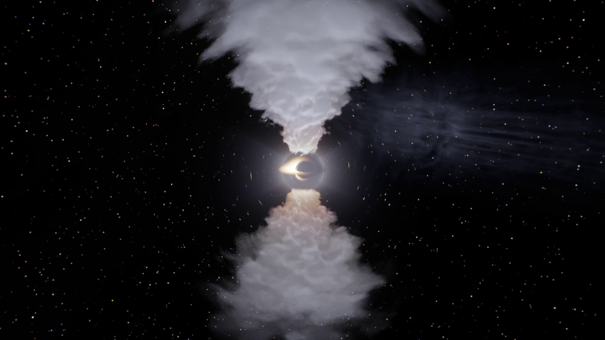

# Black Hole Simulator

A real-time simulator of a **rotating (Kerr) black hole**, and of the other things that can
sit at the center: **neutron stars** (pulsars, magnetars), **white dwarfs**, **stars** (the
Sun, red dwarfs, brown dwarfs, red giants) and **planets**. Written in C++20 and OpenGL 4.6.
Every pixel is ray traced through curved spacetime on the GPU, and everything in the scene
is lensed, Doppler-shifted and redshifted by the same physics: stars, planets, pulsars,
torn-apart stars, glowing gas, jets, even the orbit lines you draw. You can fly the camera
straight through the event horizon, or land on a neutron star.




*AT2019qiz, a star torn apart by a million-Sun black hole: the debris stream trails off to
the right while a billowing outflow erupts above and below the newly lit disk. Watch the
whole event: [docs/tidal-disruption-flare.mp4](docs/tidal-disruption-flare.mp4) (75 s).*

## What you can do

- **Choose what sits at the center:** a black hole, a young neutron star, the Crab pulsar, an
  accreting millisecond pulsar, a magnetar, a white dwarf (or Sirius B), the Sun, a red
  dwarf, a brown dwarf, a red giant, Jupiter or the Earth, each one click away with its real
  mass, radius, temperature and field, and the spin its real rotation period gives. For the
  same mass, **orbits and light bending outside the surface are identical** for all of them
  (Birkhoff's theorem): only how close you can get changes.
- **Watch two neutron stars merge, as GW170817 did:** `--merger`, or *Neutron star merger →
  Start the merger*. Two stars of 1.35 Suns and 12 km are simulated on the GPU with
  smoothed-particle hydrodynamics (12,000 particles each: self-gravity, a hot nuclear
  equation of state, shocks). Gravitational waves drain their orbit at Peters' rate and
  they spiral together. Tides draw them out into spiral arms, they collide in a flash and a
  cloud of hot debris billows out around what they merge into, a hypermassive neutron star
  at ~10^11 K, which collapses into a black hole of ~2.6 Suns
  inside a torus, ringing down at its quasi-normal frequency. A jet then breaks out of the
  debris 1.7 s after the merger (the gamma-ray burst, as GRB 170817A) and its cocoon spills
  X-ray-hot gas sideways. The r-process ejecta glow for days as a kilonova, blue then red,
  following the light curves fitted to AT2017gfo. Time runs from the last orbits
  (milliseconds) to the kilonova (days), slowing for the merger and the burst. **Two
  views**, as in the films and in the papers: a *cinematic* one (the default), ray traced
  at the screen's full resolution while the camera circles the scene, with the stars
  bending the light behind them and the spiral of gravitational waves; and a *simulation*
  one, the matter's column density seen from above with the wave and the clock; or both
  side by side. The wave is also **heard**: it is in the audible band, and it plays at its
  true pitch, live and in the videos' sound track.
- **Real sizes, real neighbours:** everything around a star or planet is at its true size
  and distance. The Moon (a quarter of the Earth's size, 60 Earth radii out, eclipsed by the
  Earth's shadow), the space station and a geostationary satellite; Io, Europa, Ganymede and
  Callisto; Mercury, Venus and the Earth around the Sun, a hot Jupiter, a sungrazing comet;
  Proxima b and d; a white dwarf's Jupiter-sized planet (WD 1856+534 b), its red-dwarf
  companion, an asteroid torn apart; gas falling onto a neutron star. Planets and moons are
  lit by their actual star. Bodies too small to see are points of light; a scale bar and a
  size readout ("about the size of a city", "1.4 times the size of the Earth") give the
  scale. The black hole's demonstrations (a star circling at 10 M) are offered around black
  holes only: 10 M from a neutron star is 20 km, where only plasma can orbit.
- **Squeeze a star:** the compactness slider keeps the mass and shrinks the radius. Watch
  the Sun turn into something as dense as a white dwarf, then a neutron star: light starts
  to bend round it until you see its back, its surface reddens, the disk stops at the ISCO,
  the photon ring appears below R = 3M, and below the Buchdahl limit (9/4 M) it collapses
  into a black hole with the same mass and spin. A white dwarf pushed over 1.44 solar masses
  collapses into a neutron star; a neutron star over ~1.64 into a black hole.
- **Surfaces drawn from their physics:**
  - **Stars:** limb darkening that is darker *and redder* toward the edge, as on the real
    Sun (cooler, higher layers show at the limb); granulation whose cells are sized from the
    pressure scale height (~1,300 km on the Sun, a handful of huge cells on a red giant) and
    boil at their real lifetimes; starspots with dark umbrae and filamented penumbrae, in
    bipolar groups in the sunspot belts; bright faculae near the limb; the white-light corona
    with the Sun's measured profile and streamers; the pink chromosphere; prominences and
    arcades of glowing loops standing over the active regions, and hedgerow prominences
    over the polar crown, seen against the sky beyond the limb; white-light flares on red
    dwarfs at Proxima's rate. In **film colors** (on by default) every object takes the look
    of films, NASA's images and artists' impressions: the Sun as SDO shows it at 30.4 nm
    (red-orange, its network and fibrils seething, active regions blazing yellow-white,
    dark filaments, a flaming limb of spicules and prominences), red giants as Betelgeuse's
    few huge cells, neutron stars, magnetars and white dwarfs in electric blue. The physics
    (where the spots, regions, hot poles, loops and field lines are, how bright) is kept;
    untick it for the true, paler blackbody colors.
  - **Brown dwarfs:** banded clouds, seen glowing in their own heat: in film colors a dark
    maroon ball wrapped in glowing, wind-sheared orange streaks, as in NASA's pictures.
  - **Neutron stars:** smooth, ~1e6 K, poles hotter than the equator (heat flows along the
    field); hot polar caps only where something heats them (gas down the accretion columns
    of an X-ray pulsar, a pulsar's return currents), sized by the field lines that land
    there, flashing as the beams sweep past; a magnetar's one current-heated hot spot and
    its bursts. Their disks are X-ray hot (millions of kelvin), a white dwarf's
    ultraviolet-hot, both from the accretion rate.
  - **Magnetospheres:** a neutron star's dipole field lines, glowing (in false color) out to
    the light cylinder or the disk's edge, bent by its gravity like everything else; a
    magnetar's twisted by a radian and wrapped in a glow of pairs; the accretion curtains
    gathered into the two streams of MHD simulations. **Pulsar beams** above and below, from
    the open field lines over the magnetic poles at the opening angle their geometry gives
    (28 degrees for the Crab, ~4 for a magnetar, the whole hemisphere for a millisecond
    pulsar), sweeping round with the star and curving back into a spiral by light-travel
    time. Accreting neutron stars launch jets at half the speed of light, as Sco X-1 does.
  - **A spinning, quaking neutron star, as in films:** the *Neutron star* is a young pulsar
    spinning 11 times a second (as Vela does), its 3e12 G field nearly aligned with its spin
    (10 degrees): a sphere of blue plasma crazed with glowing veins, white-hot at the middle
    of its face like Sirius B and ringed by a bright rim,
    whirling round three times a second on screen, while its two beams (its 4-degree core
    beams, a white-hot thread in a blue glow) stay almost still, wobbling about the spin
    axis, each pulse brighter or fainter than the last. Now and then its crust slips (a
    glitch) and rings in its torsional modes at 22 and 35 Hz, shaking the magnetic poles:
    the beams quiver and the star shimmers. Raise its *Magnetic tilt* and the beams sweep
    round like a lighthouse's.
  - **White dwarfs:** a cataclysmic variable: a red dwarf filling its Roche lobe, drawn as
    the exact equipotential, a teardrop drawn out to a point at L1 (57 white-dwarf radii
    away, turning every 1.9 hours), gravity-darkened down its nose, its gas falling from L1
    along the ballistic path of the Roche potential onto a disk truncated by its tide; the
    disk opaque and hot, in the colors artists paint these disks (white-blue at the white
    dwarf, blue, gold, orange, red at its rim, in fine rings), with the two tidal spiral
    shocks of Doppler tomography and the bright spot where the stream strikes. The white
    dwarf itself, as in artists' pictures: white-hot, marbled with deep-blue clouds of
    plasma, ringed by a blue-white rim and crackling with threads of blue plasma in a blue
    haze. Sirius B, alone, blazes the same way inside wisps of glowing gas.
  - **Accreting neutron stars:** a small, blazing star inside a thick, turbulent torus of
    plasma (the puffed-up inner disk of a bright X-ray binary), its eddies wound into spiral
    flames, launching jets wound with helical magnetic field; the millisecond pulsar's beams
    still sweep, as transitional millisecond pulsars' do while they accrete.
  - **Moons and rocky bodies:** the Moon's highlands and maria, Io's sulfur and volcanoes,
    Europa's cracked ice, Ganymede, Callisto, Mercury, Venus's clouds, dark comet nuclei,
    each at its measured albedo, airless ones lit by the Lommel-Seeliger law (a full Moon is
    evenly bright to its edge).
  - **Earth:** the real Earth from NASA's maps (the Blue Marble with the sea floor, its
    cloud cover, the Black Marble's city lights), lit by the Sun: clouds casting shadows, sun
    glint off the seas, cities on the night side, and true-scale air (100 km thick) that
    scatters sunlight blue, reddens the terminator and leaves a thin blue limb. (Without
    the maps: procedural continents, climates and cyclones.)
  - **Jupiter:** the real Jupiter from Cassini's global map, the Great Red Spot and all, with
    Minnaert limb darkening; drawn belts, ovals and festoons where the map has no data and
    for planets other than these two.

  Detail is filtered to the pixel: from afar a star is calm, and close up it resolves into
  boiling granules. Anything that strikes a surface leaves a glowing hot spot, and gas
  piling up on a neutron star or white dwarf goes off in **X-ray bursts** and **novae**. A
  magnetized star holds its disk off at the Alfven radius and feeds **accretion curtains**
  that run along its field lines to its poles.
- **Land on it:** drop the camera onto a star or planet; it reports your impact speed, the
  surface gravity and how fast clocks run there. Live readouts show the surface redshift,
  surface gravity, escape speed, how much of the surface you see at once, and how much of
  the infalling rest mass the disk and the surface release (5.7% for a black hole without
  spin, 19% for a neutron star).
- **Physical units:** give the mass and every readout also shows km, AU, seconds or hours.
  With a black hole, the tidal disruption preset then uses a Sun at its true size: Sgr A*
  tears it apart at 18 M; M87*, above the Hills mass, swallows it whole.
- **Small black holes** among the bodies lens whatever lies behind them and swallow what
  strays too close.
- **Look at a black hole:** the shadow, the photon ring, and an accretion disk whose far
  side is lensed over the top. Light from the approaching side is boosted and bluer.
  Famous holes are one click away: **M87\***, **Sagittarius A\***, **Gargantua**
  (Interstellar), **Cygnus X-1** and **AT2019qiz** (a star being torn apart).
- **Fall in:** drop the camera, or ride a plunging star, and cross the event horizon.
  Nothing marks the moment; inside, the outside universe shrinks to a patch above you and
  blueshifts as you approach the inner horizon, where the ride ends. Time slows down
  automatically near the hole so you can watch it.
- **Throw things at it:** stars, rocky planets and gas giants lit by the disk, and
  **pulsars**, whose beams flash as they sweep past you. Each one follows an exact Kerr
  orbit. Presets demonstrate precession, zoom-whirl orbits, frame dragging, plunges and
  flybys.
- **Gravity between bodies:** heavy bodies pull on each other and on gas. A **binary star**
  falling toward the hole is pulled apart: one star is captured on a tight orbit and the
  other flung out at a fifth of the speed of light (the Hills mechanism). A **planet with a
  moon** keeps it inside its Hill sphere while both race around the hole at 0.2c.
- **Spaghettification:** a star's shape follows the tides (the affine star model): it is
  drawn into an egg on the way in, squeezed at closest approach, then stretched without
  limit into a stream of 150,000 parcels of gas. A **grazing star** that passes just outside
  its tidal radius survives, wobbling.
- **The whole tidal disruption event, as in ESO's animation of AT2019qiz:** a hot blue star
  falls in from far away and is spaghettified into a fibrous stream. Half of it (here most)
  escapes in a long tail; the rest swings out and comes back one orbit later, each parcel
  after its own exact Kerr period, at a rate that rises, peaks and fades as t^(-5/3). The
  returning stream crosses itself, a small new disk lights up, and a **billowing outflow**
  erupts above and below the hole: a wide mushroom cap first, then a narrow stem once the
  disk has formed to collimate it, lit by the flare (with a light echo), self-shadowed,
  Doppler shifted and lensed. A panel plots the light curve live and gives what the event
  would be for a real Sun-like star (it returns after 41 days around a million-Sun hole and
  falls back at ~130 times the Eddington rate). One click: **Famous black holes →
  AT2019qiz**; the camera follows the event and time skips the quiet wait.
- **Gas with real physics:** the debris has pressure; where its streams cross they shock,
  heat up and glow blue-white, then radiate the heat away. Squeezed gas heats, expanding gas
  cools. There is also a **gas cloud** that is sheared into a noodle, and a **tilted ring**
  that frame dragging slowly twists.
- **Plan a launch:** set a position, velocity and mass, or just drag on the orbit map. You
  immediately get the exact verdict (*falls in*, *bound between r₁ and r₂*, *escapes*,
  *circular*), a live **effective-potential graph** showing why, and, with heavy bodies
  around, what actually happens once their pull is included.
- **See orbits in space:** trails and predicted paths are drawn into the scene as thin
  glowing lines. They are ray traced too, so a path behind the hole appears bent over it.
- **Ride along:** orbit the hole, free-fall toward it, or sit on any body. A moving camera
  sees **relativistic aberration**: the sky crowds forward and turns blue.
- **Inspect a pixel:** Ctrl+click anywhere to trace the light that reached it: its source,
  its frequency shift, how many times it circled the hole, and its travel time.
- **Light-travel delay, everywhere:** bodies, gas, the disk's pattern and the jets' knots
  are all drawn as they were when their light left them. Lensed images of a pulsar flash
  out of step; a ring of gas that has just formed is seen only partly, because light from
  its far side has not arrived yet; a torn-apart star is still seen whole until the light
  of its destruction reaches you.
- **Relativistic jets** with knots that appear to move faster than light: the jet coming
  toward you blazes and the counter-jet all but vanishes.
- **Record videos** (MP4, up to 4K, 60 fps) with Windows' built-in encoder.
- **Hear it** (*Sound*, off by default): every body hums a tone of its own, pitched by its
  kind and temperature and panned by where it is in the view; pulsars tick each time a beam
  sweeps past; the tide roars as the camera nears the hole; heavy bodies send out
  gravitational waves at twice their orbital frequency, raised in pitch to be heard (the
  true frequency is shown, millihertz around a supermassive hole). Every sound is carried
  by light: its pitch and rate are multiplied by g, the frequency ratio the light is
  coloured by, so an approaching star sings sharp and one near the horizon sinks low.
  Videos record it too.
- **Faster:** below full resolution the traced image is enlarged with FSR 1 (an
  edge-adaptive upscale after AMD's FidelityFX Super Resolution, then contrast-adaptive
  sharpening), keeping the photon ring crisp at half resolution for a third of the cost;
  *Dynamic resolution* follows a frame-time target; the GPU's time per pass is shown.
- **Spin it past the limit (a naked singularity):** tick *Naked singularity* and push the
  spin above 1. There is no horizon any more: the shadow opens up into a lensed whirl of
  sky with a bright arc on one side (the part of the photon ring that survives; Hioki and
  Maeda 2009), light that passes through the ring singularity's disk comes from a second
  region where gravity repels (its sky drawn mirrored and violet), light that strikes the
  ring is drawn white-hot, and the disk reaches in to r ≈ 0.7 M, where gas can be bound by
  more than its rest mass. (Hypothetical: cosmic censorship holds that nature forbids it.)
- **Mine a black hole's spin (the Penrose process):** a body falls in on a parabolic orbit
  that turns round deep inside the ergosphere, and splits there. One piece is thrown
  against the rotation so fast that its energy, as seen from far away, is negative; it
  falls in, and the other piece flies out with more energy than the whole body brought
  (7.5% more at spin 0.99). The hole loses that energy from its rotation and visibly spins
  down. A panel gives the energies, angular momenta and masses of all three, the gain
  (never above the 20.7% limit), and the hole's mass, spin, irreducible mass and area
  before and after, with the area theorem's check.
- **See it as the Event Horizon Telescope does:** press T for M87* or Sagittarius A* at
  230 GHz, at their real angular size in microarcseconds: the light of a hot accretion flow
  (thermal synchrotron), ray traced through the hole's spacetime with full radiative
  transfer, its density set so the total flux matches what is observed (0.5 Jy, 2.4 Jy),
  next to the same image blurred to the array's 20-microarcsecond resolution. The exact
  edge of the shadow (the critical curve), the ring the EHT measured and the beam are drawn
  on, with M87* turned to its real orientation on the sky (its jet at position angle 288
  degrees; the bright side falls in the south, as in the 2019 image). Its ring comes out
  42 microarcseconds across, as measured. Or image the black hole in the scene, from the
  camera's angle.
- **Fly a film camera:** press K wherever you want a shot, then at the next place, and
  so on. *Play* flies the camera through them on a smooth path at an even pace, easing to
  a stop where it starts, holds and ends, turning smoothly through every shot; *Record
  video → Along the keyframes* films it. *Move for real* makes the camera actually travel
  at the speed the path demands in the simulation's time, and see the sky crowd forward
  and blueshift (relativistic aberration). Keyframes are saved with the scene.
- **Go back in time:** a timeline bar along the bottom reaches back to the start. Drag it to
  any earlier moment, step frame by frame (`[` and `]`), play the past forward or
  **backwards** (Shift+Space), or jump back to the present. What you see is the scene
  exactly as it was, gas and all, not a recording: the simulation is deterministic, so the
  timeline keeps checkpoints and the length of every frame, and replays from the nearest
  checkpoint. Change anything while looking at the past and a new future starts from there.
- **Save and open scenes:** Ctrl+S saves everything that decides what happens next (the
  central object, every setting, the camera on its path, every body with its orbit, shape
  and past, the gas, the flashes and the random numbers); Ctrl+O, or dropping the file on
  the window, opens it again, and it carries on **bit for bit** as it would have. The
  scene is readable JSON, `NAME.bhscene`, with its bulky parts in `NAME.bhscene.bin` beside it.

## Download and run

A prebuilt Windows executable is in `bin\`: download the repository (*Code → Download ZIP*,
or clone it), keep its folders together, and run `bin\blackhole.exe`. It finds `shaders\`
and `assets\` in the folder above it. It needs Windows 10 or 11 and a graphics card with
OpenGL 4.6 (any NVIDIA or AMD card of the last ten years, recent Intel graphics); the C++
runtime is built in, so nothing else has to be installed. The physics tests are built
with the simulator (see *Building*).

## Building

Requirements: Windows, Visual Studio 2026 with the *Desktop development with C++*
workload (it includes CMake), and a GPU with OpenGL 4.6.

```powershell
.\build.ps1          # configure, build Release, run the physics tests
.\build.ps1 -Run     # ...and start the simulator
```

`build.ps1` uses Visual Studio 2026, or Visual Studio 2022 when 2026 is not installed. The
first configure downloads GLFW, GLM, Dear ImGui and stb (pinned versions), which
takes a couple of minutes. The executable is `build\Release\blackhole.exe`. Edits to
`shaders\` reload while it runs. To refresh the prebuilt one, copy `blackhole.exe` from
`build\Release\` into `bin\`.

## Controls

| Input | Action |
|---|---|
| Left drag | Orbit the camera around the hole (look around while moving) |
| Right drag | Look around |
| Scroll, W / S | Move closer / farther |
| A / D, Q / E | Orbit sideways / up and down |
| Ctrl+click or middle-click | Inspect the light reaching that pixel |
| I | Turn the ray inspector on or off (also a checkbox at the top of the panel) |
| Drag on the orbit map | Aim a launch (with the launch planner open) |
| Enter | Launch the planned body |
| Space | Pause or resume |
| R | Reset the camera |
| G | Toggle the lensing grid |
| Tab | Hide or show the interface |
| F12 | Save a screenshot to `screenshots\` |
| K | Add a camera keyframe where the camera is |
| T | What the Event Horizon Telescope sees (M87*, Sgr A* or this black hole) |
| Shift+Space | Play the past backwards (Space plays it forward or pauses) |
| [ / ] | One frame back / on along the timeline |
| Ctrl+S | Save the scene (to the file last saved or opened; the first time, asks where) |
| Ctrl+Shift+S | Save the scene somewhere else |
| Ctrl+O | Open a scene (or drop a `.bhscene` file onto the window) |
| Esc | Stop recording |
| H | Show the controls |

### Things to try

- **Neutron star merger → Start the merger**, *Side by side*, sound on: two neutron stars
  spiral in, chirping up from a hum to a whistle, are pulled into spiral arms and merge in a
  flash; a cloud of debris billows out, glowing white, then gold, orange and red as it
  cools, with the merged star shining through its gaps; on the right the simulation draws
  the same matter from above and the wave runs down the side. The remnant collapses, the
  camera pulls back as the ejecta billow out, the jet
  bursts from both poles 1.7 s after the merger, and the kilonova fades from blue to red
  over twelve days while the edge-on slice shows why: blue at the poles, red in the plane.
  Zoom or drag at any moment to look around (*Follow the action* gives the camera back).
- **Camera → Free fall** from the default view: watch the shadow swell, then cross the
  horizon. Or add **Plunge**, ride it (*Ride along*), and turn on *Look where you're going*.
- **Objects → Tidal disruption**, time scale ~40: the star stretches, tears apart near
  closest approach, and its debris wraps around the hole and shocks where it crosses.
- **Famous black holes → AT2019qiz** and just watch for a minute: the star falls in, is
  spaghettified, its stream sweeps round the hole and out; then the debris comes back, the
  hole flares and the outflow erupts above and below. Open **Tidal disruption flare** to see
  the light curve being drawn; try *Speed* 0.03 c (AT2019qiz's own outflow), or untick
  *Film lighting* for the true inverse-square fall-off of the flare's light.
- **Binary star**: follow the two paths; after the pair passes the hole, one star's
  energy E is below 1 (captured) and the other's above 1 (escaping).
- **Launch planner** with a **Planet with moon** present: give the launch a mass of 0.01
  and throw it near the planet; the second verdict line shows what the planet's pull does.
- **Polar orbit** at spin 0.99 with *Paths in view*: frame dragging swings the orbital
  plane around the axis, drawing a cage of loops.
- **Pulsar** plus *Light travel time*: its lensed images near the shadow flash out of step
  with the direct image.
- **Famous black holes → M87\*:** a one-sided jet nearly toward you.
- **Central object → Sun**, then drag **Compactness M/R** to the right: the Sun becomes as
  dense as a white dwarf, then a neutron star, until it collapses into a black hole.
- **Central object → Neutron star**: its crackled surface whirls round three times a second
  (time slowed ~4 times) under two nearly still beams; press **Starquake now** and they
  quiver as the crust rings. Drag *Magnetic tilt* to 70 degrees for a lighthouse: seen from
  inside the beams' cone (*Inclination* under 70) they circle the star; from outside it they
  swing to and fro, though the star turns just the same. *Roll* (Camera) turns the picture.
  Then **Camera → Free fall**: you land at about 0.55c, and the horizon around you is lifted
  by light bending.
- **Central object → Millisecond pulsar** seen from 70 degrees: the disk stops at the
  magnetosphere and the gas falls along the field onto the poles.
- **Central object → Pulsar** (the Crab): its beams sweep round every few seconds (time is
  slowed ~150 times); move the camera into a beam's path to see the polar caps flash. Untick
  *Disk* on the **Millisecond pulsar** and its accretion stops: its radio beams return,
  nearly a hemisphere wide, wound into a spiral within a few radii.
- **Central object → Magnetar**: the twisted field and its pair glow; wait for a burst.
- **Central object → Sun**, camera *Distance* down and *Field of view* to ~25: the
  chromospheric network, sunspot groups, and prominences arching over the limb.
- **Central object → Jupiter, Objects → Galilean moons**, then ride along with Io: Jupiter
  fills 20 degrees of your sky. Speed time up (the slider goes far higher around planets).
- **Central object → Earth, Objects → Moon**, camera *Distance* out to ~400: the Earth and
  the Moon at their true sizes and separation.
- **Central object → Sun, Objects → Mercury, Venus, Earth**, *Top-down* and far out: the
  inner solar system, Mercury's orbit visibly eccentric.
- **Objects → Small black hole**, with *Light travel time* off to line it up: it lenses the
  disk behind it.

## Command line

```text
blackhole [options]
  center   --naked (a black hole may spin past 1: --spin up to 1.5)
           --central earth|jupiter|brown-dwarf|red-dwarf|sun|red-giant|white-dwarf|sirius-b|
                     neutron-star|pulsar|millisecond-pulsar|magnetar|stellar-black-hole|sgr-a|m87
           --mass MSUN  --radius-km KM  --compactness R/M  --temperature K  --field GAUSS
           --physical-units
  scene    --scene default|m87|sgra|gargantua|cygnus|tde   --spin A   --jets   --no-disk
           --disk-temp K  --disk-brightness B  --relativity full|beaming|off  --no-light-delay
           --sky stars|grid|image|black   --sky-image PATH
  objects  --preset NAME (repeatable):
             isco circular retrograde precessing zoom-whirl polar plunge flyby cluster
             planet gas-giant pulsar tde tde-flare grazing binary moon cloud ring
             einstein-ring mini-hole white-dwarf penrose
             real companions: the-moon space-station geostationary asteroid-impact
             galilean-moons comet-impact inner-planets hot-jupiter sungrazer
             proxima-planets giant-planets wd-planet wd-asteroid cv-companion clump
           --advance T          simulate T M first
           --no-gravity  --no-gas-physics  --gas-collisions K  --gas-cooling T  --no-flare
           --debris-glow B  --debris-thickness K  --no-paths
  camera   --distance R  --inclination DEG  --azimuth DEG  --fov DEG
           --camera hover|orbit|fall   --ride N   --look-ahead
  output   --screenshot PATH [--frames N] [--ui] [--size WxH] [--scale S]
           --upscale bilinear|fsr   --dynamic-resolution   --sound
           --record PATH [--duration S] [--fps N] [--camera-path flown|orbit|push-in|keyframes]
  probes   --inspect X,Y   --heatmap   --debug-directions
  merger   --merger   --merger-view cinematic|simulation|split   --merger-particles N
           --merger-masses M1,M2   --merger-collapse MS   --merger-advance S
           --no-sound   --no-captions   (--distance is in km around the merger)
  scenes   --scene-file PATH   open a saved scene first (other options apply on top)
           --save-scene PATH   save the scene once set up (after --advance)
           --seek T            after --advance, go back to time T on the timeline (replayed)
           --no-timeline       record no timeline
  eht      --eht m87|sgra|here   --eht-inclination DEG   --eht-spin A   --eht-temperature K
           --eht-thickness H/R   --eht-size N
  keys     --keyframe R,INCL,AZ[,S]   a camera keyframe facing the center (repeatable), S s after the last
           --keyframes-physical       the camera moves along them for real
           --camera-path keyframes    a video's camera follows them (the video lasts as long)
```

Around a star or planet, distances (`--distance`) and times (`--advance`) are in scene units:
R/6 of length and its dynamical time (see *Scene scale* below). For example, a neutron star
seen from close by, and a 4K video of a tidal disruption seen from orbit:

```powershell
.\build\Release\blackhole.exe --central pulsar --inclination 70 --distance 22
```


```powershell
.\build\Release\blackhole.exe --preset tde --advance 300 --size 3840x2160 --record tde.mp4 --duration 20 --fps 60 --camera-path orbit
```

and the whole of AT2019qiz, from the star's approach to the outflow, as a 75-second film:

```powershell
.\build\Release\blackhole.exe --scene tde --size 1920x1080 --record at2019qiz.mp4 --duration 75 --fps 60
```

and a 13-second fly-by through four keyframes, from far away to skimming the disk and up
over the pole:

```powershell
.\build\Release\blackhole.exe --keyframe 45,80,0 --keyframe 16,62,70,4 --keyframe 9,86,160,4 --keyframe 30,25,250,5 --camera-path keyframes --record flyby.mp4 --fps 60
```

and the neutron star merger, filmed both ways (each about 85 s, with the wave's sound):

```powershell
.\build\Release\blackhole.exe --merger --merger-view cinematic --size 1920x1080 --record merger-cinematic.mp4 --duration 78
.\build\Release\blackhole.exe --merger --merger-view simulation --size 1920x1080 --record merger-simulation.mp4 --duration 78
```

## How it works

### Units, coordinates, geodesics

Units are G = c = M = 1: lengths in GM/c², times in GM/c³. For Sagittarius A*, 1 M of
time is about 20 seconds. The spacetime is the Kerr metric in **ingoing Kerr-Schild
coordinates**: r and θ are the Boyer-Lindquist ones, while t and φ are shifted along
ingoing light rays, t = t_BL + ∫(r² + a²)/Δ dr − r and φ = φ_BL + ∫a/Δ dr. That removes the
coordinate singularity at the horizon, so bodies, gas, light and the camera all cross it
in finite time. Far away the two agree.

Geodesics have four constants: energy *E*, axial angular momentum *L*, the Carter constant
*Q* and rest mass μ. In Mino time τ (dλ = Σ dτ) the equations separate:

```text
(dr/dτ)² = R(r)  = P² − Δ K,      P = E(r² + a²) − aL,   K = μ²r² + (L − aE)² + Q
(dθ/dτ)² = Θ(θ)  = Q − cos²θ [a²(μ² − E²) + L²/sin²θ]
dφ/dτ    = a F − aE + L/sin²θ
dt/dτ    = (r² + a²) F − a(aE sin²θ − L) − dr/dτ,      F = (P + dr/dτ)/Δ
```

F is 0/0 where an ingoing path crosses the horizon; on the constraint surface it equals
K / (P − dr/dτ), which is smooth there. Everything integrates the second-order form
(d²r/dτ² = R′/2, d²θ/dτ² = Θ′/2) with RK4, which passes through turning points with no
sign bookkeeping. Two numerical details matter:

- **Constraint drift.** The system conserves vr² − R exactly, including its rounding
  error. Since R ~ r⁴, that error becomes fake turning points near the hole, which is fatal
  in 32-bit floats. So velocities are re-projected onto vr² = R and vθ² = Θ away from
  turning points.
- **The spin axis.** φ swings through π as a ray grazes the axis. Steps shrink as sin θ
  does, and rays that would pass within 3×10⁻⁴ rad are sent exactly through it.

### Light (GPU, `shaders/trace.frag`)

**Camera.** The camera carries an orthonormal frame built from its 4-velocity (for a
hovering camera, the frame of the local zero-angular-momentum observer). Each pixel's
direction becomes a photon with unit energy in that frame, which makes aberration and the
camera's own blueshift automatic, and works inside the horizon, where nothing can hover.
Photons are not normalized to E = 1, since inside the ergosphere E can be zero or
negative.

**Ray marching.** Rays are traced backwards with adaptive steps. Along the way each ray
picks up the light-travel delay ∫ dt, and meets, in order:

- **Debris gas:** the parcels are binned into a (log r, θ, φ) grid. A coarse occupancy
  map skips empty space, and the gas emits and absorbs with its own Doppler shift.
- **Jets:** an analytic plasma flow along the axis at speed β. Emission is ∝ g³; the knots
  are placed as they were a light-travel time ago.
- **Path lines:** segments are binned into a grid and tested against each ray chord; a
  small occupancy texture lets most steps skip the test. Lines keep a constant on-screen
  width, and images seen through strongly bent light fade.
- **The disk:** gas on circular orbits with T ∝ [r⁻³(1 − √(r_in/r))]^¼. Its turbulence
  pattern is shown as it was a delay ago.
- **Bodies:** each body is looked up where, and in what shape, it was a delay ago, from a
  history texture; a body that has gone (torn apart, swallowed) is still drawn in light
  that left it earlier. Each ray keeps, per body, a margin it can travel before it could
  possibly reach that body, so distant bodies cost almost nothing.
- **The horizon or the sky.** A ray from outside that sinks back toward the horizon came
  out of the past horizon: the shadow. Inside the horizon every ray, followed back,
  rises to the horizon; one that gets there with E − Ω_H L < 0 entered from the far side of
  the eternal Kerr spacetime and is drawn black.

**Color.** Emitters are blackbodies seen at temperature g·T, where g = 1/(−p·u) for the
photon of unit camera energy. The color comes from a lookup of the Planck spectrum
integrated against the CIE 1931 color-matching functions.

### The central object (`src/central.*`)

Outside any spherical, non-rotating body spacetime is exactly Schwarzschild (Birkhoff's
theorem), so a neutron star, the Sun and a black hole of the same mass have the same orbits
and bend light the same way outside the star. A rotating body gets the Kerr exterior with
its mass and angular momentum, cut off at its surface r = R: exact in M and J, approximate
in the quadrupole (a real neutron star's is 2-10 times the Kerr value, a small effect below
spin ~0.4). Planets and ordinary stars have J/M^2 far above 1 (the Earth ~890); a Kerr
metric with a > 1 is a naked singularity, not a planet's exterior, so the metric uses
a = min(J/M^2, 0.99), whose frame dragging is negligible out at their surfaces anyway.

Every ray, body, parcel of gas and the camera stops at the boundary: the horizon r+ for a
black hole, R for anything else (an orbit's *fate* becomes "hits the surface"). The surface
rotates rigidly, u = u^t (1, 0, 0, Omega) with u^t = [-(g_tt + 2 Omega g_tphi + Omega^2
g_phiphi)]^(-1/2), so the light reaching the camera left it with g = 1 / (u^t (E - Omega L)),
the same form as for disk gas. The emission angle in the surface's own frame,
cos(alpha) = (p . e_r) / (-p . u) = g |v_r| / sqrt(Sigma Delta), sets the limb darkening.
Surfaces are painted in the rotating frame: longitude phi_BL - Omega (t - delay), with
phi_BL = phi - (Kerr-Schild azimuth shift). Rays meet the surface by an exact line test
against r = R (a spheroid in the Kerr-Schild Cartesian chart) on each integration step, so
a ray grazing the limb between two steps still finds it.

Readouts, for a non-rotating star: 1 + z = (1 - 2M/R)^(-1/2), surface gravity
M / (R^2 sqrt(1 - 2M/R)), escape speed sqrt(2M/R), clock rate sqrt(1 - 2M/R). Light leaving
the surface at angle alpha reaches infinity having swept
psi = integral dr / (r^2 sqrt(1/b^2 - (1 - 2M/r) / r^2)), b = R sin(alpha) / sqrt(1 - 2M/R);
the tangential ray sets how far round the star you can see (122 degrees, 76% of the surface,
for R = 5.8M; all of it below R = 3.52M). Beloborodov's 1 - cos(alpha) = (1 - cos(psi))(1 - 2M/R)
is shown for comparison.

Accretion releases 1 - E_isco onto a black hole. Onto a star, the disk releases 1 - E_in
down to its inner edge max(ISCO, R), and the gas then settles on the surface at rest
(co-rotating), releasing E_in - E_surface more: 1 - sqrt(1 - 2M/R) in all for a non-rotating
star, 19% for a neutron star. A magnetized neutron star or white dwarf stops the disk near
half the Alfven radius, r_A = (mu^4 / (2 G M Mdot^2))^(1/7) with mu = B R^3; inside, gas
follows the dipole field lines r = L sin^2(theta_m) from where they thread the disk's inner
edge to the nearer magnetic pole.

Stellar structure: the Tolman-Oppenheimer-Volkoff equations for a Gamma = 2, K = 100
polytrope give the neutron stars' mass-radius curve (1.40 solar masses at 14.2 km, maximum
1.64); white dwarfs follow Nauenberg's R = 0.0112 R_sun sqrt((M/M_Ch)^(-2/3) - (M/M_Ch)^(2/3)).
A star smaller than the Buchdahl limit, R = 9M/4, or a neutron star over the maximum mass,
collapses to a black hole with the same M and J (a black hole cannot spin faster than a = 1:
a planet's excess spin is shed first, leaving a = 0.998). A white dwarf over 1.44 solar
masses collapses to a neutron star (accretion-induced collapse).

**Scene scale.** The Sun is 471,000 M across, the Earth 1.4e9 M: far beyond what single
precision can trace (R(r) ~ r^4 overflows). So the scene is laid out in units of
s = max(1, R/6) M: 1 for black holes and neutron stars, so every existing scene is
untouched, and R/6 for bigger objects, which then look like neutron-star-sized scenes on
screen. The GPU works in these units, where the metric is Kerr with mass m = 1/s; every
GPU formula carries m (Delta = r^2 - 2mr + a^2, R'/2 = 2ErP - (r - m)K, ...). Disk radii,
preset orbits, camera limits, the time scale (s^1.5, the dynamical time), the light-delay
history and the gas's thermal scale all follow s, so the same demonstrations work around any
object. The compactness slider changes s continuously: the camera stays put in scene units
until R < 6M, then the star shrinks in a fixed frame while its relativistic effects switch on.

**Real companions at real sizes** (`src/bodies.cpp`). Scene units frame each object, but
nothing around a star or planet is scaled: bodies get their radii in km and their orbits
from measured elements (semi-major axis, eccentricity, inclination to the central body's
equator), released at apoapsis on the Kerr geodesic with that energy and angular momentum.
Around a black hole the demonstrations are unchanged; elsewhere only what could really be
there is offered (`presetAvailable`): the Moon, satellites and an impactor for the Earth;
the Galilean moons and a comet fragment for Jupiter; the inner planets, a hot Jupiter and a
sungrazer for the Sun; Proxima b and d; the scorched inner planets of a red giant; WD
1856+534 b, a Roche-lobe-filling red dwarf (separation from Eggleton's formula) and a
tidally disrupted asteroid (r_t = (3M / 4 pi rho)^(1/3)) for a white dwarf; plasma near a
neutron star. The orbit demonstrations carry, instead of a star, a plasma blob near a
neutron star or white dwarf, a satellite round the Earth, a moonlet round Jupiter, a comet
near a star. Moons and planets turn once per orbit (tidal locking) unless they have a
measured rotation (the Earth, Mercury's 58.6 days, Venus's 243 days backwards).

**Light on them.** Around a black hole the disk lights planets, as before. Around a star,
the star does, with its real flux, F / F_earth = (R / R_sun)^2 (T / 5772 K)^4 (1 AU / d)^2,
drawn so that the Earth's sunlight is daylight (the same exposure as a planet at the
center). Around a planet, the Sun along a fixed direction, cut off in the planet's shadow
with a penumbra as wide as the Sun's half-degree disk makes it.

**Points of light.** A body smaller than a pixel is drawn kPointRadiusPixels = 0.75 pixels
across, dimmed by (R / R_drawn)^2 so that it sends the same light, but no fainter than a
quarter of a lit pixel, so it can be found against the sky.

**Size and scale.** The readouts give each object's size against the nearest familiar one
(a city, the Moon, the Earth, Jupiter, the Sun, Mercury's orbit, the Earth's orbit), and a
scale bar at the bottom of the view gives a round length at the center's distance.

**Time.** Moons and planets take days to years to go round, so around stars and planets the
time slider runs up to 1e5 dynamical times a second. The light-delay history then samples
about 64 times a frame rather than every half scene unit of light travel (around the Earth
light crosses the scene ~30,000 times per dynamical time), and predicted paths cover a
whole orbit, its period from the energy, a = M / (2 (1 - E)).

### What surfaces look like (`src/surface.*`, `shaders/surfaces.glsl`, `shaders/central_surface.glsl`)

**Limb darkening (Eddington-Barbier).** In a grey atmosphere T^4(tau) = (3/4) Teff^4
(tau + 2/3), and light leaving at mu = cos(angle from the normal) comes from tau ~ mu: the
limb shows cooler, higher gas. Drawn as a blackbody at T(mu) = Teff (3/4 (mu + 2/3))^(1/4),
it integrates to Eddington's (2 + 3 mu) / 5, and in visible light is darker in the blue than
the red, within ~5% of the Sun's measured darkening at 550 nm.

**Granulation.** Convection cells are ~10 pressure scale heights across,
H_p = k T / (mu m_H g) with mu = 1.3: 134 km on the Sun, so granules of ~1,300 km; on a
1-solar-mass red giant of 100 R_sun (g 10^4 times lower) a few cells per radian. They live
as long as gas rising at a fifth of the sound speed takes to cross one: ~14 minutes on the
Sun, months on the giant. Drawn as cellular noise (bright, domed centers; dark lanes; some
"exploding" granules) whose cells drift and fade at that lifetime, with an rms temperature
contrast of 2.9% (13-15% in intensity, as observed) on dwarfs and 5% on giants, whose broad,
fuzzy lanes merge cells into larger bright regions. The supergranulation network (25 times
larger) and the plage around active regions brighten toward the limb (faculae).

**Starspots.** Generated per star: on Sun-like stars, bipolar groups in two belts near 15
degrees (the butterfly diagram), the leader spot nearer the equator and ahead (Joy's law,
tilt ~ latitude / 2), the follower behind, pores between; on red dwarfs, fewer, much larger
spots at any latitude, often one over a pole; on giants, a few huge ones. Umbrae are cooler by
1,850 K e^((T - 5772 K) / 1200 K) (~1,850 K on the Sun, ~190 K on Proxima: the trend of
Berdyugina 2005), penumbrae by 17% of that, with radial filaments.

**Corona and chromosphere.** The white-light (K) corona is photospheric light
Thomson-scattered by electrons: n_e = 1e8 (2.99 rho^-16 + 1.55 rho^-6 + 0.036 rho^-1.5)
cm^-3 (Baumbach-Allen) times the dilution W = (1 - sqrt(1 - 1/rho^2)) / 2, integrated along
each line of sight (straight: around a star light bends by microradians). This reproduces
Baumbach's measured brightness profile within 5% from 1.02 to 6 R, calibrated to 1e-6 of
the disk at 1.1 R and then brightened (the slider; 1e5 by default) since the real corona
shows only in eclipses. Helmet streamers sit over the equator and the active regions,
narrowing outward into rays, with plumes over the poles. The chromosphere is a thin
exponential layer (scale height 0.2% of R, ragged with spicules) glowing pink in H-alpha and
H-beta beyond the limb: exp(-h/H) sqrt(2 pi R H) along a grazing line.

**Flares.** A red dwarf like Proxima flares every few hours: a patch near a spot group
flashes at ~9,500 K, rising in about a minute and fading over ten (Kowalski et al. 2013),
at that rate in the star's own time.

**Neutron stars.** Heat flows along the field far more easily than across it, so
T^4 = Tp^4 cos^2(Theta_B) + Teq^4 sin^2(Theta_B) (Greenstein and Hartke 1983), Theta_B
the angle between field and normal, Teq = 0.6 Tp. The crust is otherwise smooth (its
"mountains" are millimetres high). Polar caps are hot only where something heats them:
gas channelled down the accretion columns (~1e7 K), within sin^2(theta) = R / r_m where a
disk is stopped at r_m; or a rotation-powered pulsar's return currents (2.5 times the
surface temperature), within sin^2(theta) = R Omega of the pole (the open field lines that
reach the light cylinder). An old neutron star fed at its equator has none. A magnetar's
heat comes from currents in its twisted field: one hot spot off the dipole pole, ~2 times
the surface temperature over several percent of the surface (as on XTE J1810-197).

**Starquakes.** A young neutron star's spin slows and its crust, solid and strained, now
and then slips: a glitch (Vela's spin jumps by ~2 parts in a million every ~3 years). The
crust then rings in its torsional modes, shear waves with no radial motion, at
f_l = f_2 sqrt((l − 1)(l + 2) / 4), f_2 = 22 Hz (Hansen and Cioffi 1980; Samuelsson and
Andersson 2007), as in the 18-30 Hz oscillations after SGR 1806-20's giant flare. The
field is anchored in the crust, so its footpoints, the magnetic poles, swing back and
forth: the beams wobble, by the angle the poles had when their light left (so the wobble
runs out along each beam), and the shearing crust brightens and dims in the mode's
Legendre pattern. Each quake rings down with Q = 60 (the core's field drains the crust's
oscillations within seconds) and flashes the star's glow.

The *Neutron star* is drawn as films show one: a sphere of blue plasma crazed with glowing
veins (cells of Worley noise fixed to the star, so they show its spin), white-hot at the
middle of its face (brightness rising as the square of the cosine of the view angle, as
Sirius B is drawn), cyan farther out, and brightening again to a rim where the line of sight grazes a thin glowing layer; its beams are the narrow core
beam, 1.22 deg / sqrt(P) at half maximum (Rankin 1990), with a white-hot thread along the
middle, in a soft violet-fringed glow, fading as 1/r instead of 1/r² so that they reach
across the view, and fading near the camera; no field lines (tick *Field lines* for
them). It is framed with the picture turned (*Roll*), its spin axis diagonal. Each
pulse is randomly brighter or fainter than the last and flickers within, as real pulsars'
do; the change is set by when the light left the star, so it runs out along the beam.

The catalogue's neutron stars: a young pulsar with Vela's spin and field (89.3 ms,
3.4e12 G) nearly aligned (tilted 10
degrees, no disk); the Crab
pulsar (33.7 ms, 3.8e12 G tilted 60 degrees, no disk); an accreting millisecond X-ray pulsar
like SAX J1808.4-3658 (401 Hz, 2e8 G: the disk stops at ~26 km); a magnetar (7.5 s,
1e15 G, 4e6 K). Their disks' peak temperature follows from the accretion rate,
sigma T^4 = 3 G M Mdot / (8 pi r^3) (1 - sqrt(r_in / r)) at r = 49/36 r_in (~3e6 K at 1%
of Eddington: X-rays; ~19,000 K for a white dwarf), and their brightness from the disk's
temperature against the surface's: two blackbodies at the same temperature are equally bright.

**Magnetospheres and beams.** The field is a dipole, r = L sin^2(theta_m) about the
magnetic axis, turning rigidly with the star. Lines with apex L inside the light cylinder
R_LC = c / Omega (1,608 km for the Crab), and inside a disk's inner edge, close; a shell of
nine lines every factor 1.45 in L is drawn, out to 7 R. The lines are found exactly along
each (curved) ray chord: the chord crosses sheets of constant magnetic azimuth, and at each
crossing the distance to the line within the sheet, dL sin^3 / sqrt(1 + 3 cos^2) of the
apex step, gives a Gaussian tube's glow, sqrt(pi) w across, more along the sheet. A
magnetar's field is twisted (azimuth turning by ~1 radian between a line's footpoints,
Thompson, Lyutikov and Kulkarni 2002) and threaded by a pair corona glowing as r^-4. Beams
come from the open lines: radio is made ~400 km P^0.3 above the star (Kijak and Gil 2003),
where the last open line has sin^2(theta) = r_em / R_LC and points
rho = theta + atan(tan(theta) / 2) from the axis (3/2 theta near the pole): 26 degrees for
the Crab, as the 5.75 deg / sqrt(P) of measured conal beams (Rankin 1993); 77 degrees for a
401 Hz pulsar. Each beam is a core a fifth of rho wide in a fainter hollow cone, drawn as if
lighting a faint haze (flux ~ 1 / r^2), the same power brighter in a narrower beam; light
seen at r left the star r / c earlier, so fast pulsars' beams trail into spirals.
Accretion curtains climb out of the disk most readily under the pole tilted toward it,
gathering into two streams (Romanova et al. 2003), threaded along the field.

**Prominences and loops.** Over each active region the field arches from one polarity of
the spot group to the other: an arcade of four loops side by side along the group (tilted
by Joy's law), each an arc of a circle sunk half its radius below the surface, ~2,500 km
thick and up to a tenth of the radius high, glowing in H-alpha (pink) and knotted with gas.
Three hedgerow prominences (sheets of vertical threads) hang over the high-latitude filament
channels, and a tall arch stands on the limb of the first view. The glow of each tube is
found exactly along the line of sight: where a steep line pierces the loop's plane, or,
for a line running along the plane, where its projection crosses the circle; the tube is
locally straight there, and its Gaussian profile integrates to
sqrt(pi) w / sin(gamma) exp(-D^2 / w^2) (gamma the angle between them, D their closest
distance). Against the disk they are lost in its glare.

**Film colors.** A blackbody's true color is pale: 5,772 K is white, 3,000 K peach (the
tone curve keeps that). Films, NASA's images and artists' impressions show these objects
otherwise, and film colors (on by default) follow them while keeping the physics' layout:
- **The Sun as SDO shows it** (its 30.4 nm channel, He II at ~80,000 K, in its black, dark
  red, orange, yellow, white color table): the supergranule network as a broad bright mesh,
  mottled by spicules and fibrils; enhanced network where old regions decay; the active
  regions (the spot groups' own) blazing yellow-white in streaks along their bipoles;
  filaments, the prominences seen from above, as dark threads; coronal holes dim over the
  poles; the limb brightened (the thin layer seen edgewise) and fringed by a spicule
  forest; prominences and loops orange-yellow. The Sun is drawn near the maximum of cycle 25
  (2024-26), so many regions are out. Cooler stars take the same table, redder. This
  surface is baked into a 2048 x 1024 map of the star by its own small shader
  (shaders/sdo_bake.frag; a sixteenth of it refreshed each frame, so it keeps evolving):
  drawn inside the ray tracer its registers slowed every ray, doubling the frame time.
- **A red giant as ESO shows Betelgeuse:** a handful of huge, soft, bright convection
  plumes (interferometry and the models find fewer, larger cells than the pressure scale
  height alone suggests) on a deep red-orange star, its limb darkened deeply, wrapped in
  its glowing extended atmosphere (molecular layers and shed dust, falling off over ~0.2
  radii and then slowly) with plumes of gas thrown off at a few spots.
- **Electric blues** for neutron stars, magnetars and white dwarfs (their light is mostly
  ultraviolet and X-rays): a white-hot core fading to blue at the limb, the surface seething
  (fixed to the star, so it shows the spin), the physics' hot poles and spots riding on it
  (a white dwarf's marbled with deep-blue clouds: domain-warped noise, its limb rimmed
  blue-white; around it threads of plasma, the crests of ridged noise on shells out to
  2.2 R twisted with height, in a blue haze falling off over 0.2 R);
  denser shells of field lines (12, or a magnetar's 16, per shell), each with a soft halo,
  white-hot near the star; beams white along the axis, blue at the edge. A white dwarf
  blazes inside the streamers of a corona, in blue.
- **Other stars' palettes** in log T (stars hotter than ~7,000 K): white near 8,000 K, blue
  above 10,000 K. **Brown dwarfs:** a dark maroon ball wrapped in thin, wind-sheared orange
  and pink cloud streaks along the latitude bands. **An accreting neutron star's flow:** near
  a bright neutron star radiation pressure and heating puff the inner disk up (H/r ~ 0.1-0.3
  near the Eddington rate), and simulations show a thick turbulent torus: drawn as a
  glowing, absorbing volume (scale height 0.17 r) along the bent rays, its eddies in trailing
  spiral streams wound by the Keplerian shear (renewed every flow period, as the thin disk's
  are), hotter inward, its approaching side beamed brighter (g^3), over a faint midplane.
  Seen from 150 M, the star is small inside it, as in artists' impressions.
A camera exposed for a star's surface records no faint stars (the Sun's disk is ~1e10
times brighter per area than the starry sky): around stars and white dwarfs the sky is
dimmed to 4% and their glare blooms; around neutron stars a little less.

**A cataclysmic variable.** A white dwarf fed by a disk has a companion: a red dwarf of
0.15 solar masses and 0.19 solar radii filling its Roche lobe. Eggleton's (1983)
r_L / a = 0.49 q^(2/3) / (0.6 q^(2/3) + ln(1 + q^(1/3))) (q = 0.25) puts it a = 494,000 km
(57 white-dwarf radii) away, a 1.9 hour orbit. It takes the shape of the Roche
equipotential through L1 (Kopal 1959): in the frame turning with the binary, separation 1
and G (M1 + M2) = 1, Phi = -mu1 / r1 - mu2 / r2 - ((x - mu2)^2 + y^2) / 2, a teardrop whose
tip is a cusp at L1. Each ray chord through the sphere that bounds the lobe samples Phi 40
times and bisects the first crossing; the surface normal is grad Phi, and the effective
gravity |grad Phi| darkens it (flux ~ g^(4 x 0.08), Lucy 1967's exponent for convective
envelopes; zero at L1). L1 is the root of the Roche potential's gradient between the stars,
-1/x^2 + q/(1 - x)^2 + (1 + q) x - q = 0 (0.637 a from the white dwarf). The stream is the
ballistic path from rest at L1 in the rotating Roche potential, integrated by RK4 (Lubow
and Shu 1975): Coriolis bends it ahead of the companion; it would swing within
r_min = 0.0488 q^-0.464 a of the white dwarf, but strikes the disk, which the tide
truncates at 0.6 a / (1 + q) = 0.48 a (Paczynski 1977). Its gas heats from ~3,500 K to
~14,000 K as it falls, widening. The disk is optically thick and smooth; the companion's
tide raises two open spiral shocks in its outer half (Doppler tomography of IP Peg,
Steeghs, Harlaftis and Horne 1997), and where the stream strikes, its bright spot; both
turn with the binary. In film colors the disk's brightness is compressed (fourth root,
capped below white so its hottest part stays blue), as an exposure for the whole disk would
show it, in the colors artists give these disks by temperature (white-blue above ~35,000 K,
blue, pale gold at 10,000 K, gold, orange, red below ~5,000 K), and its annuli drawn as fine
rings. The companion takes the Sun's ultraviolet colors made redder, its face toward the
white dwarf heated, darker down its nose, glowing again where its gas pours out at L1.

**Helical jets.** The disk's rotation winds the field it launches into helices around
each jet: three strands per jet on its surface, a turn every ~6 M at the base, loosening
outward (7 ln(1 + z / 6 M) radians), found exactly along each ray chord as the field lines
are.

**An Earth-like planet.** Continents from warped fractal noise with ridged mountain
chains; climate from latitude (wet tropics, deserts near 25 degrees where the Hadley cells'
air sinks, wet mid-latitudes, cold poles and peaks) choosing real surface reflectances
(forest ~0.05, desert ~0.35, snow ~0.8, ocean ~0.03); hill shading; clouds by latitude
(the intertropical band, clear subtropics, stormy mid-latitudes) wound into cyclones, with
reflectance tau / (tau + 6) so their edges are thin, and shadows ~6 km below; sun glint off
the sea (the GGX microfacet model for a 5 m/s wind, Cox and Munk, with water's Fresnel
reflection); city lights on the night side. Its air is drawn at true scale by single
scattering: Rayleigh scattering by molecules (5.8, 13.6, 33.1 per 1,000 km at sea level,
scale height 8 km), Mie scattering by aerosols (1.2 km, forward-peaked, g = 0.8) and
ozone absorption, with the sunlight's path through the air from the Chapman function
(Schuler 2012), so the terminator reddens and the planet's limb glows blue.

**Jupiter.** Its belts and zones at their real latitudes, the band edges sheared by noise
warped through itself; the Great Red Spot (22 degrees south, 12 by 8 degrees, turning
counter-clockwise) with its collar; white ovals; festoons on the North Equatorial Belt;
grey polar regions; Minnaert limb darkening (k = 0.9). A brown dwarf gets banded weather of
its own, seen in its thermal glow.

**Filtering.** Each pixel knows its size on the surface (distance times pixel angle,
stretched toward the limb). Noise octaves and cells smaller than a few pixels fade into
their average instead of sparkling, so the same surface reads correctly from any distance.
Each kind of surface is compiled into its own variant of the ray tracer, and bodies are
shaded after the integration loop, so none of this slows the black hole's ray tracing.

**Small black holes** among the bodies (no exact spacetime holds two black holes) bend
light in the thin-lens approximation: a ray passing at impact parameter b turns by 4m/b
toward the small hole, in the local ZAMO frame at fixed local frequency, after which E, L
and Q are recomputed from its new direction; rays passing within 3 sqrt(3) m are captured.
Each small hole bends a given ray once, at its closest approach.

### Matter

**Bodies** (CPU, double precision, `src/bodies.cpp`) integrate in coordinate time and record
a 2048 M history (position, 4-velocity, shape) used for the light-travel delay. New bodies
are integrated backwards to fill in their past.

**Gravity between bodies** (`src/gravity.cpp`): kick, drift, kick. Between kicks each body
follows its exact Kerr geodesic; a kick adds the Newtonian pull of the others to its
4-velocity, measured in the body's own rest frame: each separation runs between events
simultaneous *for that body* and its length comes from the metric. That last point
matters: measuring separations on the coordinate time slices (or in ZAMO frames) gave a
pair moving at 0.2c a steady spurious torque that spun a moon out of its planet's grip
within a few orbits; with the relativity of simultaneity included it stays put.

**Tidal deformation** (`src/tidal.cpp`): the affine star model (Carter & Luminet 1983). A
star is a homogeneous ellipsoid x = F X whose deformation evolves in its proper time under
the hole's tide, its own gravity (index symbols via Carlson's R_D) and its pressure. The
tidal tensor uses the exact Schwarzschild eigenvalues in the star's frame,
(M/r³)[2 + 3K/r², −(1 + 3K/r²), −1], with Carter's K. A uniform star is more fragile than
a real, centrally condensed one, so its dynamical frequency is calibrated to make full
disruption set in at β = r_t/r_p ≈ 0.9, as hydrodynamic simulations of γ = 5/3 stars find.
Once its longest axis passes 2.5 radii it is torn apart, and the debris inherits its shape
and its internal velocity field dF/dτ X.

**Gas** (GPU, `shaders/particles_update.comp`): each parcel follows its own geodesic in
float32 with the same constraint projection. Once a frame it also feels the rest of the
gas through a full-precision grid (a particle-mesh method), as a kick in its local frame:

- *pressure*, P = (γ − 1) ρ u, from the gradient of the gridded ρT;
- *collisions*: parcels relax toward the local mean velocity at a rate ∝ density. Smooth
  flows are untouched; crossing streams lose their relative motion as heat, which is
  what shocks do and what turns tidal debris into a disk;
- *adiabatic heating and cooling*: each parcel carries its entropy T/ρ^(γ−1), so its
  temperature follows the local density without accumulating noise;
- *radiative cooling* at a rate ∝ T³, down to a floor set by the surrounding light;
- the pull of heavy bodies.

With light delay on, each parcel also carries the copy of itself the camera sees, a
light-travel time behind (straight-line distance plus the Shapiro delay), and those copies
are what is drawn.

**Launch verdicts** (`src/trajectory.cpp`) are exact for a test particle. The motion is
confined between the zeros of R(r) around the start: no zero inward means it falls in, and
no zero outward means it escapes. The effective potential V(r) is the root of R(r; E) = 0 in
E. With heavy bodies around, the planner also simulates the launch together with them on a
worker thread.

### Tidal disruption flares (`src/tde.*`, the outflow in `shaders/trace.frag`)

When a star is torn apart (`BodySystem::disrupt`) its debris is analysed at once
(`tde::analyze`). For each parcel, the zeros of R(r) give its turning points r_p < r_a, and
its radial period is the exact Kerr one,

```text
T_r = 2 ∫ (dt/dτ) / sqrt(R) dr  from r_p to r_a,     dt/dτ = (r² + a²) P / Δ + aL − a²E <sin²θ>
```

With R = (1 − E²)(r_a − r)(r − r_p)(r² − s r + q), where s and q follow from the sum
2/(1 − E²) and product a²Q/(1 − E²) of the four roots, the substitution
r = (r_a + r_p)/2 − (r_a − r_p)/2 cos χ cancels the square-root singularities at both turning
points, leaving a smooth integral in χ. The time to the next pericenter is the same integral
from the parcel's χ, plus the Kerr-Schild shift timeShift(r_p) − timeShift(r): the
simulation's clock. (The polar motion enters through <sin²θ>, exact for equatorial orbits.)
Unbound parcels leave; bound ones return after their own period. Their return times,
binned in ln t and smoothed over 4%, give the **fallback rate** Ṁ_fb(t), which for a flat
spread of energies is (1/2ΔE)(1/3)(2π)^(2/3) t^(−5/3).

The returning stream crosses itself (it has precessed by tens of degrees at pericenter),
shocks and settles into a **disk** out to the circularization radius 2 r_p (gas keeping the
stream's angular momentum sqrt(2 M r_p) circles there); it appears once 2% of the star has
come back and shines with the flare. A share f (*Blown out*, 0.5) of the returning gas is
driven out; the rest is accreted with the hole's efficiency η = 1 − E_isco. For a
Sun-like star the accretion power would be l = η (1 − f) Ṁ_fb c² / L_Edd, up to ~70 L_Edd
around a million-Sun hole; most of that light is trapped in the inflow and what escapes
is l for l < 1 and 1 + ln l above (Begelman 1979). That is the flare's light curve.

**The outflow** coasts radially from R₀ = 2 r_p: v(R)² = v∞² + 2M/R (energy conservation,
Newtonian: it starts well outside the hole), so the time from R₀ to R is, in closed form with
k = v∞², T(R) − T(R₀), where T(R) = sqrt(R(kR + 2M))/k − (2M/k^1.5) ln(sqrt(kR) + sqrt(kR + 2M)).
A point at R, seen at time t_e, holds gas launched at t_l = t_e − (T(R) − T(R₀)), so its
density is mass conservation in the cone at that moment,

```text
ρ(R, t_e) = f Ṁ_fb(t_l) / (Ω(t_l) R² v(R))
```

Its half-opening angle starts wide, θ₁ = 3 × 14°, because before a disk exists the
self-crossing shock throws gas out every which way, and narrows to θ_late = 14° as a disk
forms and collimates the wind: θ = θ_late + (θ₁ − θ_late) exp(−M_returned / 0.2 M_bound). The
first, widest gas makes the cap; the funnel that follows, the stem. The app tabulates
Ṁ_fb, θ and the flare's luminosity over the last few thousand M (a 1D texture), so every
point is drawn as it was when its light left it.

Drawing it: the wind scatters far more than it absorbs, so the flare's light (as it was a
light-travel time R ago: a light echo) reaches a point through optical depth τ toward the
center as e^(−τ) + 0.5 / (1 + 3τ/4) (unscattered plus two-stream diffusion), with the smooth
wind counted at 12% (porosity: light leaks between clumps) and the billows just inward in
full, so puffs shade their own far sides. Scattering is Henyey-Greenstein (g = 0.4); the gas
recedes from the flare (sqrt((1 − v)/(1 + v))) and moves relative to the camera (g from its
4-velocity, as for all gas), and is seen at temperature g T with intensity ∝ g³. Near R₀ it
still glows from the shocks that launched it, cooling adiabatically as R^(−4/3). The
billows are drawn on coordinates that ride with the gas: its direction across the cone
(in units of the cone's width, turned back by the swirl ℓ/(v R₀) (1 − R₀/R) its angular
momentum gives it) and its launch time. The tracer skips a ray step at once unless it
comes within the widest the cone can be seen at that radius (64 radii, from the app).

**Strands.** Every debris parcel carries a Lagrangian label: where it sat in the star,
across the direction the tide stretches it (the eigenvectors of FᵀF other than the
largest). The grid averages the labels too; they vary smoothly across the stream, so a
pattern drawn in label space gives strands finer than a voxel that move with the gas.

The returning debris of the simulated star (1.5 M across, tidal radius 16 M, pericenter 6 M
on a parabolic orbit) comes back within ~900 M instead of the weeks a real star takes: it is
scaled up to be seen. Its gas is as hot inside as its own gravity makes it, (3/7) G m / R* per
unit mass; it glows blue-white (display only), lit by its leftover heat and the flare.

### Neutron star mergers (`src/merger*`, `shaders/merger_*`)

Units are G = c = 1 with the Sun's mass as 1: lengths of 1.4766 km, times of 4.9255 µs.

**The stars.** Each is an n = 1 polytrope, P = K ρ², whose radius does not depend on its
mass: R = √(πK/2), so K = 2R²/π gives 12 km for both stars and a central density of
1.2×10^15 g/cm³ for 1.35 Suns. Its particles start on a face-centred cubic lattice,
each moved outward so that the share of particles inside it equals the share of the
polytrope's mass, m(r) ∝ sin ξ − ξ cos ξ with ξ = πr/R (a "stretched lattice": far quieter
than random positions). A few hundred damped steps then settle the stars into SPH
equilibrium. Each particle keeps where it started in its star as a label, which travels
with the matter.

**The inspiral.** While the stars are farther apart than 40 km they are carried whole along
Peters' circular inspiral, a(t) = a₀(1 − t/T)^(1/4), T = 5a₀⁴/(256 m₁m₂M), with the
orbital phase integrated from Kepler's ω = √(M/a³). From 40 km every particle is followed.

**The hydrodynamics** (`merger_density.comp`, `merger_force.comp`, `merger_integrate.comp`,
`merger_reduce.comp`): standard SPH with the M4 cubic spline and ~58 neighbours
(h = 1.2 (m/ρ)^(1/3)), found through a hashed grid whose cells are as wide as the cores'
kernels, with the particles put in Morton order every 16 steps so that neighbours sit
together in memory. The equation of state is the hybrid one of merger simulations,
P = Kρ² + (Γ_th − 1)ρu_th with Γ_th = 1.75: the cold part is barotropic, so only the thermal
energy is evolved, heated by Monaghan's artificial viscosity (α = 1, β = 2, with Balsara's
switch so that the remnant's shear is not damped). Gravity is every particle on every
other, Plummer-softened, summed in tiles in shared memory. The orbit loses energy through
the 2.5PN radiation-reaction force (Iyer & Will 1993),
a = (8/5) η M²/r³ [(3v² + 17/3 M/r) ṙ n − (v² + 3M/r) v],
applied to the two stars' centres and shared by mass, until their cores touch; on a
circular orbit it drains energy at exactly the quadrupole rate. Time steps follow the
Courant and force limits; kick-drift-kick leapfrog.

**The waves.** Each step the GPU sums d²I/dt² = Σ m (2vv + xa + ax), the second derivative
of the mass quadrupole, and the strain seen from direction n at distance D is the
transverse-traceless part of h = (2/D) d²I/dt². Before the hydrodynamics starts it is the
point-mass formula with Peters' phase.

**The collapse.** At the chosen moment (15 ms after the merger by default; a 2.7-Sun
remnant of a soft equation of state lasts milliseconds to a second) the remnant collapses.
Walking outward from its densest point, a bound parcel falls in unless its specific angular
momentum exceeds the ISCO's, 2√3 M(<r) (Schwarzschild); the hole's mass and spin come from
what falls in, and the rest stays as a torus. From then on the hole pulls with the
Paczyński–Wiita potential −M/(r − 2M), swallowing what comes within 2.5M, and the wave
continues with its l = m = 2 ringdown (Berti, Cardoso & Will 2006): Mω = 1.5251 −
1.1568(1 − χ)^0.1292, Q = 0.7 + 1.4187(1 − χ)^−0.499 (6.6 kHz for 2.6 Suns at χ = 0.7).
Eight milliseconds later the hydrodynamics stops and unbound matter coasts on in straight
lines.

**The debris cloud.** The collision itself throws out a few thousandths of a Sun, the
dynamical ejecta (Hotokezaka et al. 2013; Sekiguchi et al. 2016; Radice et al. 2018): tidal
tails flung from the stars' far sides into the orbital plane, and gas squeezed out of the
shocked interface between the cores, faster (up to ~0.3 c) and more toward the poles. In
the picture (`DebrisCloud` in `src/merger.h`) 0.005 Suns leave the stars' surface (15 km) as
they touch, the edge coasting at 0.3 c, 90 km further each millisecond. Shocked to
~5×10^10 K, they cool adiabatically as radiation-dominated gas does, T ∝ 1/R. The two tails
trail from the line the stars touched along, wound back by the turning binary, thin in the
plane and fanning out; the shocked gas puffs out all round. Both break into billows
(Kelvin-Helmholtz and Rayleigh-Taylor turbulence frozen into the coasting gas, from noise
baked into a 128³ texture, `merger_noise.comp`), lit from within by the remnant, each billow
shaded by the one inside it. The true cloud's optical depth, 3κM/(4πR²) with electron
scattering, is ~10^15 at first and still hundreds after an hour: it would hide the remnant
at once. It is drawn thinning as the true one does, as 1/R², but from 3 optical depths (at
115 km) instead, and handed over to the kilonova's components once it is thinner than a
few tenths, about 5 ms after the merger. Its colour is its temperature, shown compressed
(2,500 K at 10^9 K, rising as the square root): white as it leaves, then gold, orange and
red as it expands, the unshocked tails cooler and redder than the shocked gas. The cores'
collision is a flash rising within 40 µs and fading over 0.4 ms.

**The kilonova.** The three components fitted to AT2017gfo (Villar et al. 2017): blue
(0.020 Suns at 0.256 c, κ = 0.5 cm²/g), purple (0.047 at 0.152 c, κ = 3) and red (0.011 at
0.137 c, κ = 10, lanthanide-rich). They are heated by r-process decay (Korobkin et al. 2012:
4×10^18 (½ − arctan((t − 1.3 s)/0.11 s)/π)^1.3 erg/g/s, ~2×10^10 at a day), of which the
share Barnes et al. (2016) fit is kept. Each component's light curve is Arnett's,
L(t) = e^(−(t/t_d)²) ∫ 2Mε(t′)(t′/t_d)e^((t′/t_d)²) dt′/t_d with
t_d = √(2κM/(βvc)), β = 13.7, and its photosphere glows at (L/4πσ(vt)²)^(1/4) until it
cools to the fitted floor. The blue component peaks within a day, the red later; together
they give ~5×10^41 erg/s a day after the merger. In the picture each component expands
homologously (r = vt, so its clumps are frozen in velocity space) out to 1.25 times its mean
speed, its optical depth from 3κM/(4πr²) and its surface brightness from its photosphere's
temperature: the blue in lobes toward the poles, the purple slightly flattened, the red in a
disk in the orbital plane (as the tidal tails left), along the directions the simulation's
own unbound matter took. Once the hydrodynamics stops, the simulation view turns edge-on
and shows this structure as a slice through the spin axis, colored by composition, with the
jet's funnel and cocoon, beside the light curve.

**The jet.** A jet launched along the hole's spin axis 0.8 s after the merger drills
through the ejecta with its head at 0.7 c; their edge along the axis (the blue component's)
coasts at 0.37 c, so it breaks out at t = 0.7 × 0.8/(0.7 − 0.37) = 1.7 s, the delay between
GW170817 and GRB 170817A. Its core
(~5°, Γ ≈ 100) is Doppler-boosted ~2Γ along the axis and de-boosted below 1 a few tens of
degrees off it, which is why the burst seen ~25° off-axis was so faint. After breakout the
hot cocoon spills sideways at 0.3 c.

**The clock.** The event spans milliseconds to weeks, so time is shown at a rate that grows
with the time to or from the merger: 0.32 e-folds of the time to the merger per second
of viewing before it, 2,500 times slow motion at the merger, then 0.18 and, once the
hole has formed, 0.55 e-folds per second, held back around the burst.

**The cinematic view** (`merger_view.frag`) marches each pixel's ray through the scene,
bending it with x″ = −3M h² x/r⁵ (h = |x × x′|) for each star, which is exact outside one
spherical mass (u″ + u = 3Mu²: the photon sphere and the √27 M shadow follow), and capturing
it inside 2M of the hole. The simulation's matter is spread onto a 128³ grid and absorbs and
glows by density and temperature, Doppler-boosted by its motion and textured by its labels
(veins of hotter plasma that stretch with the tides); the gravitational wave is drawn where
the ray crosses the orbital plane, as Re[H(t − r) e^(−2iφ)]: the two-armed spiral the
quadrupole sends out at the speed of light. It is traced at the screen's full resolution
(about 22 ms a frame at 1920 × 1080 on a laptop RTX 5050 while the debris cloud billows),
and the camera circles the scene by itself, a full turn every 45 s, rising and dipping
every 50 s. **The simulation view** (`merger_map.frag`)
is the column density through the orbital plane on a 1024² map, on a log scale through the
"inferno" color map, with the strain of the wave seen face-on and the clock.

**The sound** is the wave itself at its true frequency (a few hundred Hz rising to kHz, then
the remnant's ~3 kHz ring and the hole's 6.6 kHz ringdown), its amplitude relative to the
loudest, following the picture's slow motion; the burst adds a rumble (space carries no
sound: this is a film's convention). Videos of the merger carry it as an AAC track.

### Scene files (`src/scene_file.*`, `src/json.*`)

A scene is everything that decides what happens next, so that a loaded scene runs on
exactly as the saved one would have. `NAME.bhscene` is JSON: the central object; every
setting (but VSync, which belongs to the screen); the camera, with its geodesic, its proper
time and the body it rides; every body with its constants of motion (E, L, Q), its state,
mass, size, temperature, its tidal shape F and Ḟ, its trail; the bodies that are gone but
whose light is still on its way; impacts; the tidal disruptions so far, each with its
fallback table; the events; the coordinate time; the history's step; and the full states
of the random number generators (Mersenne twisters, 624 words each). Doubles and floats
are written in their shortest form that reads back to the same bits (`std::to_chars`);
infinities travel as strings. Numbers are kept as the text they were written with until a
field reads them, as a double or as a float, so nothing is rounded twice.

`NAME.bhscene.bin` holds the bulky parts as tagged chunks: every body's light-delay history
(512 KB a body: 8,192 samples of position, 4-velocity and shape), the 96-byte parcels of
gas exactly as they sit on the GPU (their light-delayed copies included), and the
surface's hot spots. The JSON records the sidecar's size and FNV-1a checksum, so a sidecar
from another save is refused. Both are written to temporary files first, then renamed.

Loading checks everything before anything changes. The gas physics reads the gas grid of
the frame before, which the file does not hold: the first step after loading rebuilds it
from the restored parcels in a pass that only deposits them (as the saved run had done
after its last step), then steps. The grids are sums of fixed-point integers, which do not
depend on the order the GPU adds them in, so the run continues bit for bit: saving,
loading and saving again gives the same files, and a scene loaded and run on for 60 M
saves to the same bytes and renders to the same pixels as the original run for 120 M
(checked with a gas cloud, a binary and a star on its way to disruption; a neutron star
with gas striking it, starquakes and a falling camera; and AT2019qiz after the disruption).


### The timeline (`src/timeline.*`)

The simulation is deterministic: from the same state, the same frame steps do exactly the
same thing, bit for bit (the scene files show it). So the timeline keeps checkpoints,
whole scenes as a scene file would hold them, every 25 M of scene time, and the length of
every frame between them. The gas goes into a buffer of its own on the GPU (copied there
without being read back). To show an earlier moment, the scene is restored from the last
checkpoint before it and the logged frames are replayed up to it without being drawn, at
most 30 ms of them a frame; played on, the replay retraces exactly what happened. Played
backwards, each frame is a restore and a short replay.

Settings that change what happens (the central object, gravity between bodies, the gas
physics, what sets off flashes) are logged with the frame they first apply to and replayed;
settings that only change the look are not, so scrubbing never undoes your exposure. What
you do to the scene itself (add a body, set off a burst, start the camera falling) is
noticed by a fingerprint of the bodies, the gas and the flashes taken at the end of every
frame: if it changed by the next, a checkpoint is taken at once and kept, so no replay runs
across it from before. Done while looking at the past, either one starts a new future, and
the old one is dropped. When the memory fills up (256 MB of checkpoints, 512 MB of gas on
the GPU), every other checkpoint goes, so the whole run stays reachable, with longer
replays.

### Naked singularities (spin above 1)

For a > 1, Δ = r² − 2r + a² = (r − 1)² + b² > 0 everywhere (b = √(a² − 1)): no horizon. The
ring singularity sits at r = 0 in the equator, where Σ = r² + a²cos²θ vanishes. Mino-time
R(r) and Θ(θ) are polynomials, regular at r = 0, so a ray through the ring's disk (r = 0
with θ ≠ π/2) is simply integrated on into r < 0, a second asymptotic region in which the
hole's gravity repels; near the ring, step sizes are set by √Σ rather than r (otherwise
steps shrink without end as r → 0). Rays that leave to r → −∞ show that region's sky,
mirrored and tinted violet; rays that reach Σ < (0.02 M)² end on the singularity, drawn
white; without a horizon to end them, rays near the photon orbits wind round many times,
and get four times the step budget. Matter, jets and orbit paths live only in our region
(r > 0), and the disk only crosses there.

The Kerr-Schild shifts take their closed forms, ∫(r² + a²)/Δ dr − r = ln Δ + (2/b)
arctan((r − 1)/b) and ∫a/Δ dr = (a/b) arctan((r − 1)/b). The equatorial photon orbits solve
r(r − 3)² = 4a²: past a = 1 the prograde one (between M and 3M) is gone, which is why the
shadow opens on that side, and the retrograde one lies beyond 3M. The ISCO is where the
circular orbits' energy is least (dE/dr = 0), found numerically: 0.67 M at a = 1.1, 0.75 M
at a = 1.3, where E is 0.03 and 0.33: a disk there would release 97% and 67% of the rest
mass (just above a = 1, more than all of it). The outer edge of the ergoregion exists only
where a²cos²θ < 1.

### The Penrose process (`src/penrose.*`)

Measured by the local zero-angular-momentum observer (ZAMO), with lapse α = √(ΣΔ/A),
frame-dragging rate ω = 2ar/A and circumferential radius ϖ = √(A/Σ) sin θ, a particle of
velocity v has energy E = γ(α + ωϖ v_φ) and angular momentum L = γϖ v_φ per unit mass.
E < 0 needs v_φ < −α/(ωϖ), possible below c only where α < ωϖ: in the ergosphere.

The body comes in on the prograde parabolic orbit (E = 1, Q = 0) whose closest approach r
satisfies R(r) = 0, i.e. (2 − r)L² − 4aL + 2(r² + a²) = 0 (the smaller root), with r 70%
of the way from the ergosphere's edge to the horizon (but outside the marginally bound
radius, which no infalling body passes and returns). There, its fall halted, it splits:
its 4-momentum in the ZAMO's frame is shared, m₀γ₀(1, v₀) = m₁γ₁(1, v₁) + m₂γ₂(1, v₂), so
m₀E₀ = m₁E₁ + m₂E₂ and likewise for L. Fragment 1 is thrown at 0.95 c; its direction (in
the r-φ plane) and mass are searched for the largest gain −m₁E₁/(m₀E₀) among splits where
fragment 1 must fall in and fragment 2 must escape (from the zeros of R(r), as in the launch
planner). Fragment 1 shares the body's past (its light-delay history). When it crosses the
horizon the hole's mass changes by δM = m₁E₁ and its angular momentum by δJ = m₁L₁, and its
spin becomes a′ = (a + δJ)/(1 + δM)². The area never shrinks: δM − Ω_H δJ = m₁(E₁ − Ω_H L₁)
≥ 0 with Ω_H = a/(2r₊), the condition P(r₊) ≥ 0 that any body crossing the horizon meets.
What rotation can give at all is M − M_irr, M_irr = √(A/16π) (Christodoulou:
M² = M_irr² + J²/(4M_irr²)), 29.3% of M at a = 1; a single split at the horizon of a
maximally spinning hole gains at most (√2 − 1)/2 = 20.7%.

### What the Event Horizon Telescope sees (`src/eht.*`, `src/eht_view.*`)

**The image plane.** A distant observer at inclination i sees the light that arrives with
impact parameters (α, β) in M (Bardeen 1973): L/E = −α sin i, Q/E² = β² + (α² − a²) cos² i,
the sign of p_θ from the sign of β. Each pixel's ray starts 1,000 M out and is traced back
with the same Mino-time integrator as everything else; rays that reach the horizon are the
shadow. Its exact edge is the critical curve, from the spherical photon orbits of radius r
between the prograde and retrograde ones:
ξ = [r²(3 − r) − a²(r + 1)]/[a(r − 1)], η = r³[4a² − r(r − 3)²]/[a²(r − 1)²],
α = −ξ/sin i, β = ±√(η + a²cos²i − ξ²cot²i); a circle of radius √27 M without spin.
M subtends θ_g = GM/(c²D): 3.82 µas for M87* (6.5e9 Suns at 16.8 Mpc), 5.13 µas for Sgr A*
(4.3e6 Suns at 8.28 kpc), so the shadow of a hole without spin would be 39.7 and 53.3 µas.

**The flow** (after Broderick and Loeb 2006): electrons of density
n_e = n₀ r^−1.1 exp(−z²/2(hρ)²) and temperature T_e = T₀ r^−0.84 in a field
B = √(8π n_e m_p c²/(6βr)) (plasma β ≈ 10), rotating at 0.9 of the Keplerian rate outside
the ISCO and plunging along the ISCO's geodesic inside it, where it thins as it speeds up
(r² n u^r constant). Its 4-velocity gives each point's frequency shift
g = 1/(−p·u) = 1/(u^t − L u^φ − p_r u^r) for the photon's covariant momentum.

**Radiative transfer.** Along each ray, front to back from the camera, with the affine
length dλ = Σ dτ_Mino (× GM/c² in cm) and the fluid frame's path dλ/g:
I_obs = Σ_k e^(−τ_k) g_k³ S_k (1 − e^(−Δτ_k)), Δτ_k = α_k Δλ_k / g_k, the exact solution
of a step with constant source function S = j/α. The emissivity is thermal synchrotron
(Leung, Gammie and Noble 2011): ν_c = eB/(2πm_ec), θ_e = kT_e/(m_ec²),
ν_s = (2/9)ν_c θ_e² sin θ_B, X = ν/ν_s,
j_ν = n_e √2 π e² ν_s /(3K₂(1/θ_e)c) (X^½ + 2^(11/12) X^(1/6))² exp(−X^(1/3)), at the emitted
frequency ν/g, for a tangled field (sin θ_B = √(2/3)); K₂ from Abramowitz and Stegun's
approximations, with exp(1/θ_e) folded into the exponent so cool gas does not underflow.
Absorption follows Kirchhoff, α_ν = j_ν/B_ν(T_e). n₀ is found by a secant iteration on
small images until the total flux F = 10²³ Σ I Δα Δβ θ_g² Jy matches the observed one.

**What is shown.** The model image (linear brightness to its 99.5th percentile, matplotlib's
"afmhot" color map as in the EHT's figures), and the same image convolved with a Gaussian of
the array's resolution (20 µas FWHM). The ring's diameter is measured on the blurred image
as twice the mean radius of peak brightness from the shadow's center over 72 directions:
42.1 µas for M87* (spin 0.5, T₀ = 1.5e12 K, H/R = 0.5) against the EHT's 42 ± 3. Images are
made on worker threads, a quick 64-pixel look first.

### Sound (`src/scene_sound.*`)

Space carries no sound, so this is a film's convention, but each sound rides on light. For
every body the frequency ratio g is estimated from the light it sends the camera: its clock
against the camera's (the ZAMO lapses √(ΣΔ/A)) times the Doppler factor
√(1 − v²)/(1 − v·n) of its velocity relative to its ZAMO along the line of sight n (light
bending is left out here, unlike in the picture). A tone's pitch is its own times g,
louder by g² and for nearer bodies, panned by the body's direction against the camera's
right. A pulsar ticks twice a turn (two beams) at its turning rate in the simulation's time
times g, louder by g³ (beaming). The rumble's level grows as (6M/r)³, as the tide. A body
over 0.1% of the hole's mass radiates gravitational waves at twice its orbital frequency
(Ω/π per M), heard 400 times higher; the panel gives the true frequency, (Ω/π)/(GM/c³).
Voices are mixed in stereo with equal-power panning, their pitch, loudness and panning
ramped across each buffer so nothing clicks, and limited softly (tanh); videos get a mono
mix as an AAC track.

### Speed

**FSR 1.** Traced below the window's size, the image is tone mapped at the traced size
(16-bit), then enlarged by an edge-adaptive upscale after AMD's FidelityFX Super Resolution
(EASU): 12 nearby pixels weighted by a polynomial Lanczos-2 kernel rotated to the local edge
(found from luma differences around the 4 nearest, bilinearly weighted), stretched along it
up to √2, narrowed across it and with a weaker negative lobe where there is no edge, then
clamped to the 4 nearest pixels' range so it cannot ring. Robust contrast-adaptive
sharpening (RCAS) follows: each pixel against its 4 neighbours with the strongest negative
lobe that keeps it within their range (at most −3/16), scaled by 2^(−sharpness); the dither
that hides banding comes last. At 1920×1080 traced at half resolution: 14.9 ms against
48.5 ms at full, with the photon ring nearly as crisp.

**Dynamic resolution** scales the traced resolution by √(target/measured) each frame
(the cost follows the pixel count), smoothed and stepped by 1/40 so the targets are not
reallocated every frame, between 0.4 and 1. **Timers:** GL timestamp queries around the
ray trace, the bloom and the tone map with the upscale, read back three frames later so
the GPU never stalls.

### Camera keyframes (`src/keyframes.*`)

A keyframe is the camera's place (Kerr-Schild Cartesian), its orientation (a quaternion
turning its right, up and backward axes onto Cartesian ones), its field of view, the
seconds to the next keyframe and a hold. The path through the places is a **centripetal
Catmull-Rom spline**: knots t_(i+1) = t_i + |P_(i+1) − P_i|^(1/2), evaluated with Barry and
Goldman's pyramid of linear interpolations; it passes through every keyframe and never
loops or forms a cusp within a segment (Yuksel et al. 2011), as the uniform kind can when
keyframes are unevenly spaced. Each end is extended by reflecting its neighbour.

Each segment is **reparametrized by arc length**: its length is tabulated at 32 steps
(five-point Gauss-Legendre quadrature of |dP/du|), and a distance is turned back into the
spline's parameter by Newton's method from the table, so equal distances take equal time.
The distance along the path follows a monotone cubic through the times the camera is due at
each keyframe (Fritsch and Carlson: the speed at each keyframe is the mean of the two
segments' speeds, limited so that (m_i/d)² + (m_(i+1)/d)² ≤ 9, and zero where it starts,
holds and ends): the camera keeps to the schedule, never backs up, and eases in and out.

The orientation follows **squad** (Shoemake 1987): slerp(slerp(q_i, q_(i+1), h),
slerp(s_i, s_(i+1), h), 2h(1 − h)), with h the fraction of the segment's length covered.
Shoemake's inner points s_i = q_i exp(−(log(q_i⁻¹q_(i+1)) + log(q_i⁻¹q_(i−1)))/4) turn
smoothly only when every segment is crossed at the same rate; here segments differ in
length, so the turning rate per unit length is matched instead (the non-uniform
Catmull-Rom tangent in the quaternions' log space, scaled by each side's length, giving an
inner point for each side). The field of view is a Catmull-Rom of the keyframes' values.

The camera hovers at each point (a *cinema* camera: at rest relative to the local ZAMO,
no aberration). With **move for real**, it is given the path's velocity: dP/dt divided by
the coordinate time passing per second, less the ZAMO's frame-dragged motion ω ẑ × P, on
the local axes and over the lapse, boosted onto the ZAMO's frame as u = γ(e₀ + vⁱeᵢ), and
capped at 0.99 c. The ray tracer then sees the sky aberrated and Doppler shifted as from
any moving camera.

### Tests (`tests/test_kerr.cpp`)

480 checks against exact results:

- neutron star mergers: GW170817's chirp mass (1.188 Suns) and its 24 Hz, ~100 s before
  the merger; the chirp frequency equals twice Kepler's at Peters' separation; a(t) =
  a₀(1 − t/T)^(1/4); the 2.5PN reaction loses energy at the quadrupole rate (1e-12), and
  integrating it from 40 M to 12 M takes Peters' time (1%); a circular binary's strain is
  4μM/(aD) face-on, half that and no × polarization edge-on; the polytrope's central
  density (1.2e15 g/cm³), mass and hydrostatic equilibrium (1e-6); a stretched-lattice star
  of exactly n particles following the mass profile; temperatures from thermal energy; a
  cold ball collapses whole while a Keplerian ring at 40 M stays out, with no spin; the
  Schwarzschild ringdown (Mω = 0.3737, τ ≈ 11 M) and 6.6 kHz for 2.6 Suns at χ = 0.7;
  r-process heating 2e10 erg/g/s at a day falling as t^−1.3; the blue kilonova peaking
  within a day before the red, ~5e41 erg/s in all at a day, the red photosphere at its
  floor late on; the jet breaking out at 1.7 s; on- and off-axis Doppler factors; the clock;

- tidal disruption flares: a Sun torn apart by a million-Sun hole starts coming back after
  41 days and falls back at up to 3 Suns a year; t_min ∝ M^(1/2); Kepler's 2π a^1.5; the
  Eddington luminosity and the photon-trapping law; radial periods and times to the next
  pericenter (inbound and outbound) against brute-force integration (Schwarzschild, a = 0.9,
  an eccentric orbit like the debris; 2e-5); a wide orbit's period is Kepler's; a flat dM/dE
  gives half bound, the first return at the most bound period and t^(−5/3) to 2%; the wind's
  closed-form travel time against direct integration (1e-8) and its front; the opening
  angle's limits; a real parabolic disruption analysed in well under a second, about half
  escaping, fading roughly as t^(−5/3); the debris labels across the stretch;

- surfaces: grey limb darkening integrates to (2 + 3 mu) / 5, darker and redder at the
  limb, the Sun's measured darkening at 550 nm; solar gravity, scale height (134 km),
  granule size (1,000-1,500 km) and lifetime (5-20 min); a red giant's few huge cells;
  umbral temperature drops (1,850 K on the Sun, a few hundred K on red dwarfs); sunspot
  latitudes and red dwarfs' larger spots; the K-corona profile against Baumbach within 6%
- neutron stars: the core beam (1.22 deg at P = 1 s, 4.1 deg for Vela); the crust's
  torsional modes (22 Hz, and sqrt(5/2) times that for l = 3); the catalogue's young
  neutron star turns in Vela's 89.3 ms, a turn every ~2.6 s on screen;
- pulsars: the light cylinder c P / 2 pi; the radio emission height 400 P^0.3 km; the beam
  angle of the last open field line against Gil et al.'s 1.24 deg (r_em / 10 km / P)^(1/2)
  (2%) and Rankin's 5.75 deg / sqrt(P) for the Crab (20%); magnetars a few degrees,
  millisecond pulsars over 60, faster pulsars wider, the hemisphere when every line is open;
- close binaries: Eggleton's Roche lobe (0.379 a for equal masses); L1 against Plavec and
  Kratochvil's fit (1.5%, q = 0.1 to 1) and halfway for equal masses; the ballistic stream's
  closest approach against Lubow and Shu's r_min = 0.0488 q^-0.464 a (6%, q = 0.1 to 0.5);
  the stream bending ahead of the companion and ending at the tidally truncated rim; the
  Roche potential's gradient against finite differences, no net force at L1, the volume of
  the lobe (integrated over directions) against Eggleton's radius (1%, q = 0.1 to 3), the
  lobe reaching L1, and its teardrop shape (pole < side < back < point);
  from 1.02 to 6 R, and its calibration; which look each object gets;

- units and the catalogue (1 M of M87* is 64 AU; the Sun is 471,000 M);
- real objects: spins from rotation periods (the Crab 0.015, the Earth ~738, the Sun 0.22);
  the millisecond pulsar's disk held off at ~26 km; which kind of place each catalogue
  object is; sizes in words (a neutron star is a city, a white dwarf 1.4 Earths, a red
  giant as wide as Mercury's orbit); sunlight 1 at 1 AU falling as 1/d^2, and Proxima's
  luminosity; the thin disk's hottest ring at 49/36 r_in by brute force, T ~ Mdot^(1/4),
  neutron-star disks at 1e6-1e7 K and white dwarfs' at 1e4-5e4 K; unresolved bodies drawn
  as points of the same total light; which demonstrations are offered where; plasma, not
  stars, at a neutron star's ISCO; the Moon at its real size and apogee, going round in the
  Kepler period (27.45 days for a test mass) and keeping its perigee (363,300 km) after two
  orbits integrated at r ~ 1e11 M; Mercury's 88-day year and 0.307 AU perihelion;
- neutron-star surface: 1 + z = 1.2355, surface gravity 0.0367/M = 1.6e12 m/s^2; the Sun's
  redshift (0.636 km/s) and limb deflection (4M/b = 1.751"), against the exact integral;
  Sirius B's 77 km/s;
- light bending at R = 5.8M: the ray tracer's integrator against the exact integral to
  1e-6 rad; Beloborodov's approximation; the whole surface visible below R = 3.52M;
- a radial photon from a static surface arrives with g = sqrt(1 - 2M/R) (to 1e-9), and the
  emission angle formula the GPU uses against the surface element's own frame;
- Birkhoff: the same orbit is bound around a black hole and a 4.5M star, and hits a 5.8M one;
- Mercury's perihelion: 42.98" per century from the exact Schwarzschild formula;
- TOV (1.40 solar masses, 9.586 = 14.2 km; maximum 1.637) and Nauenberg (8,660 km);
- accretion efficiencies (5.72%, 32%, 19.1%), the Alfven radius, the Hills mass (1.14e8),
  tidal radii at Sgr A* (17.8 M) and M87* (swallowed whole);
- collapse rules, the compactness stages, the scene scale, the thin-lens deflection 4m/b
  (in the ray tracer too) and capture inside 3 sqrt(3) m;

- horizon, ISCO and photon-orbit radii, and circular-orbit E and L;
- the Kerr-Schild metric (its known inverse, and flat-plus-null form in the Cartesian
  chart), and the coordinate shifts against Boyer-Lindquist rates;
- free fall through the horizon against the exact cycloid, with finite coordinate time;
- observer frames orthonormal outside and inside the horizon; looking up from inside the
  horizon shows the sky, looking down shows darkness;
- the ray tracer's frequency-shift formula against −p·u, inside the horizon too;
- conservation over thousands of M; the exact Schwarzschild precession; the separatrix;
- the shadow edges for a = 0 and 0.9 to 0.1%; near-axis rays;
- a moving observer's measured energy, and the head-on Doppler factor;
- the tidal model: index symbols (sphere, sum rule, prolate spheroid), equilibrium, the
  relativistic tide on a circular orbit, disruption at β = 2.3 and survival at β = 0.86;
- gravity between bodies: a binary's Kepler period, and a moon of a planet moving at 0.22c
  staying bound;
- the tidal energy spread and ring inclinations of the debris;
- the fate classifier against brute-force integration;
- the radial light-travel time [r + 4 ln(r − 2) in Kerr-Schild time];
- the ray inspector's classification of shadow, sky and disk;
- scene files: doubles and floats (the smallest denormal, the largest double, −0) come
  back bit for bit, infinities and NaN too, escapes and UTF-8 survive, a malformed file is
  refused with its line; a scene with a disrupted star, a binary, a precessing orbit and a
  falling camera saves, loads and saves to identical files, and the loaded copy evolves
  bit for bit like the original (random numbers included, a preset added afterwards lands
  in the same place); a changed sidecar, an impossible value (reported with where it is,
  nothing changed) and a newer version are refused;
- the timeline: bodies pulling on each other, stepped by frames of uneven length, with
  bodies added along the way: any moment restored from a checkpoint and replayed is the
  scene as it was, bit for bit; no replay runs across what the user did; thinning keeps
  the first, the latest and the pinned checkpoints and stays exact; a new future drops
  the old one and records on;
- naked singularities: Δ > 0 everywhere, least b² at r = M; no horizons; the closed-form
  shifts' derivatives are 2r/Δ and a/Δ, for r < 0 too (1e-8); the retrograde photon orbit
  solves r(r − 3)² = 4a² (1e-10) and the prograde one is gone; dE/dr = 0 at the ISCO, a
  minimum inside r = M; a ray through the ring's disk comes out at r < 0, keeping
  vr² = R and vθ² = Θ (1e-6);
- the Penrose process: the ZAMO-frame energy and angular momentum match the geodesic's
  (1e-12); outside the ergosphere no split gives negative energy; a parabolic orbit turns
  round at the split radius; there the best split conserves energy and angular momentum
  (1e-12), gains −m₁E₁, and stays below (√2 − 1)/2; of 4,000 random throws from the
  ergosphere, everything that falls in has E − Ω_H L ≥ 0 (the area theorem); Christodoulou's
  identity (1e-12), 29.3% extractable at a = 1, the area 16πM² without spin; the hole spins
  down, loses mass and gains area; the preset run through: the body splits, one piece
  falls in, the other escapes with more energy;
- the Event Horizon Telescope: M of M87* subtends 3.82 µas and of Sgr A* 5.13 µas; their
  shadows without spin are 39.7 and 53.3 µas; the shadow traced from the image plane follows
  the critical curve to 0.2% (a = 0.9 at 17° and 60°, a = 0 as a circle of √27 M); K₂ at
  0.5, 1 and 10, and K₂(1/θ) → 2θ²; a blackbody's brightness temperature is its
  temperature; synchrotron emissivity scales with density and cuts off above ν_s; an image
  calibrated to M87*'s 0.5 Jy, its approaching side the brighter, its shadow of the
  critical curve's area (5%);
- camera keyframes: a camera's place and view as a keyframe and back (1e-9); the spline
  passes through every keyframe (1e-9), facing each one's way at its field of view when
  due; arc-length speed varies by under 1%; the camera rests at the start, through holds
  and at the end, and never turns back; the turning rate just before and after a
  keyframe agrees (squad weighted by length; Shoemake's alone was 41% out); a path moving
  with the frame dragging is at rest for the ZAMO; faster than light is capped; keyframes
  saved and read back bit for bit.

## Project layout

```text
src/kerr.*         Kerr physics: radii, metric, geodesics, observer frames, photons
src/central.*      the central object: catalogue, units, surface physics, light bending,
                   accretion, TOV and white-dwarf structure, collapse
src/surface.*      what surfaces look like: limb darkening, convection scales, starspots,
                   the corona's profile
src/trajectory.*   fate classification, path prediction, effective potential, ray inspection
src/tidal.*        the affine model of a tidally deformed star
src/gravity.*      gravity between bodies, joint path prediction
src/debris.*       initial conditions for disrupted stars, clouds and rings (with labels)
src/tde.*          tidal disruption flares: return times, fallback, flare, outflow
src/merger.*       neutron star mergers: inspiral, waves, polytropes, collapse, ringdown,
                   the debris cloud, kilonova light curves, the jet, the clock
src/merger_sim.*   the merger's GPU hydrodynamics (shaders/merger_*.comp)
src/merger_scene.* the merger as a scene: time, camera, both views, captions, sound
src/audio.*        sound through Windows' waveOut (mono or stereo)
src/scene_sound.*  the scene's sound: tones, pulsar ticks, the tide's rumble, waves
src/bodies.*       orbiting bodies, presets, tidal disruption, light-delay history
src/particles.*    GPU gas: buffers, physics, grids, light-delayed copies
src/renderer.*     ray-trace, bloom and tone-map passes; path-line binning
src/camera.*       hovering, orbiting, falling and riding cameras
src/recorder.*     MP4 encoding with Media Foundation
src/ui.*           control panel, launch planner, orbit map, ray inspector
src/scene_file.*   saving and loading scenes (.bhscene and its binary sidecar)
src/timeline.*     the timeline: checkpoints, the frames between them, replays
src/keyframes.*    camera keyframes: the spline, even speed, squad, real motion
src/penrose.*      the Penrose process: ZAMO energies, the split, the hole's spin-down
src/eht.*          the Event Horizon Telescope's view: image plane, critical curve, flow,
                   synchrotron radiative transfer, flux calibration, blur
src/eht_view.*     the telescope view: worker threads, the two images and their labels
src/json.*         a small exact JSON reader and writer
src/file_dialog.*  Windows' Open and Save As dialogs
src/app.*          window, input, main loop, scenes, command line
shaders/           GLSL; reloads while running (sdo.glsl and sdo_bake.frag: the Sun's
                   baked ultraviolet surface)
assets/planets/    NASA maps of the Earth and Jupiter (public domain; CREDITS.md)
bin/               the prebuilt Windows executable (the simulator)
docs/              screenshots, the AT2019qiz film, and design notes
refrence photos/   reference images the looks were matched against
tests/             physics tests
```

## Approximations

- Naked singularities: the gas is not followed through the ring (parcels inside r = M are
  dropped), the ray inspector and the launch planner's fates assume a horizon, and bodies
  that reach r = 0.05 M are removed (at the ring, or into the r < 0 region).
- The Penrose process changes the hole's spin but keeps lengths in units of its original
  mass (the body is 2% of it, so the hole's mass changes by ~0.15%); the split is
  instantaneous, and the fragments are test particles on geodesics.
- The sound's frequency shifts ignore light bending and frame dragging (the picture's do
  not); its gravitational waves have the pitch, not the amplitude, of the quadrupole's.
- No static-camera cache: every pixel is traced every frame, even with the camera still.
- The telescope view's flow is a smooth, semi-analytic model, not a turbulent, magnetized
  simulation; its electrons are thermal and the field tangled. Seen face-on, gas inside
  ~5 M projects onto the shadow: with a fast spin (ISCO at 2 M) it fills the shadow in this
  model, so M87* is shown at spin 0.5 by default (the image alone hardly constrains it).
  Sgr A*'s ring comes out ~58 µas against the 52 measured. No interstellar scattering (it
  blurs Sgr A* further) and no polarization.
- A camera moving for real along keyframes takes its velocity from the path's coordinate
  velocity, measured on the local axes and corrected for frame dragging and the lapse, but
  not for the curvature of space near the hole (exact far out). The ZAMO frame's axes are
  taken as the local r, θ, φ directions, which they match up to O(a/r²).
- The timeline replays what moves exactly, but the gas's light-delayed copies (what the
  camera sees of it) are recomputed for the camera you have now, so moving the camera while
  scrubbing changes them as it should; the camera that follows a tidal disruption eases
  with the frame's real time, which is logged.
- A saved scene continues bit for bit on the same GPU and driver; another GPU may round the
  gas's single-precision arithmetic differently, so its gas drifts apart from the original
  (the bodies, on the CPU, do not). The neutron star merger cannot be saved: it runs a
  simulation of its own.
- Bodies feel the hole exactly and each other through Newtonian gravity (in their own rest
  frames); there are no gravitational waves and the hole is not moved. A body's past, used
  for light delay, is integrated without the others' pull.
- The star's tidal response is the affine model: a homogeneous ellipsoid, calibrated to
  match the disruption threshold of real stars; partial disruptions lose no mass. The tidal
  tensor uses the Schwarzschild form with Carter's K for spinning holes.
- The gas is a particle-mesh model on a 160×96×256 grid: pressure, collisional shocks,
  adiabatic heating, a simple T³ cooling law and a floor temperature. There is no radiation
  transport, no magnetic field and no self-gravity, and the temperature scale is compressed
  so that the gas glows in visible colors. The bodies' pull on the gas is applied in local
  ZAMO frames.
- Tidal disruption flares: return times come from each parcel's orbit when the star comes
  apart (Kerr, exact up to the polar average); the gas's later pressure and shocks are not
  fed back into them. The flare's light curve uses the luminosity of a Sun-like star at the
  hole's mass, while the simulated star is scaled up so its debris returns in minutes. The
  outflow is a kinematic model (ballistic, with mass conservation), not a simulation: its
  opening angle law, the share blown out, the swirl and the billows are set, not computed,
  and it does not push the debris. Its opacity is a free display parameter: a real
  super-Eddington wind is optically thick out to its photosphere far beyond what is drawn,
  hiding the inside. *Film lighting* lets the flare's light fall as R^(−0.7) instead of
  R^(−2). The new disk lies in the hole's equatorial plane (Bardeen-Petterson alignment of
  the inner disk). Strands and the debris's glow color are drawn, not simulated.
- The gas's light delay is that of the direct image; its lensed images show the same moment.
  With the camera inside the horizon the gas is drawn as it is now.
- The disk is thin and glows as a blackbody at visible temperatures. Jets are an analytic
  flow, not a simulation.
- A falling camera stops just above the inner (Cauchy) horizon, where the Kerr interior
  stops being trustworthy, or just above the singularity of a non-spinning hole.
- Stars and planets have the Kerr exterior (right in M and J, not in the quadrupole) cut off
  at a spherical surface (no rotational flattening), with a = min(J/M^2, 0.99). Their
  surface turns at Omega = J / I (I = k M R^2), never faster than mass shedding allows
  (Omega ~ 0.65 sqrt(M/R^3)); squeezing a star keeps J, even past that limit, so a collapse
  inherits it. The Hartle-Thorne metric is not used.
- Surfaces hotter than 30,000 K are drawn at a compressed color temperature,
  30,000 (T / 30,000)^0.3 K (a 1e6 K neutron star shows as ~86,000 K).
- The corona is brightened 1e5 times by default (adjustable down to the real 1e-6 of the
  disk); city lights are brightened as in long exposures; the chromosphere's rim is drawn at
  ~15% of the disk. Earth's air is at true scale but scatters light once (no multiple
  scattering), and its ozone follows the Rayleigh profile with the right column instead of
  a layer near 25 km. Hill shading is exaggerated (real relief is ~1e-4 of the radius).
- Continents, clouds, Jupiter's eddies, starspots and granules are procedural: physically
  sized and placed, but not maps of the real ones. Spots and clouds do not evolve (they live
  days to months); granules do. Limb darkening assumes a grey atmosphere (no spectral lines).
- Accretion curtains are drawn with the gravitational redshift of a static emitter (no
  Doppler shift from the infall). Hot spots from gas use a map of the surface as it is now
  (no light delay); bodies' hot spots and surface-wide flashes are light-delayed. X-ray
  bursts and novae recur on visual time scales (hundreds to thousands of M), not the real
  hours to millennia, and fade in ~30 and ~300 scene units.
- The compactness slider's "stages" (white-dwarf-like below R = 30,000 M, neutron-star-like
  below 30 M) set typical temperatures and fields; real white dwarfs and neutron stars sit
  on their mass-radius relations, and no stable star exists between R ~ 10 and ~1,000 M.
- Small black holes lens in the thin-lens approximation (no exact two-black-hole spacetime
  exists); the bend fades out beyond 2000 m, where it is below a pixel.
- Around big objects (scene scale s > 1) the gas's temperature scale, cooling time and
  collision rate are scaled with s so that it behaves as it does around a black hole.
- Real companions are test masses on Kerr geodesics of the central mass alone (pulling on
  each other with gravity between bodies on): the Moon takes the 27.45 days of a test mass,
  not the real 27.32 (the Earth-Moon pair turns about their common center); the red dwarf
  of a cataclysmic variable, a quarter of its white dwarf's mass, circles ~12% too slowly;
  it is drawn as a sphere, not the teardrop of a Roche-lobe-filling star, and no stream
  flows from it to the disk. Orbits are released at their nodes; precession of the Moon's
  orbit and obliquities (the Earth's 23.4 degrees) are left out: everything turns about the
  central body's spin axis. Proxima b and d have their measured orbits; their radii assume
  rocky compositions, and their surfaces (never seen) are drawn as bare rock.
- Planets and moons are lit at the Earth's daylight exposure, F / F_earth times it: a
  sunlit surface is drawn about as bright as the Sun's surface, where in reality the Sun is
  ~1e5 times brighter. Light from the central star is capped at 30 times the Earth's (a
  planet beside a white dwarf or neutron star saturates). Points of light are drawn no
  fainter than a quarter of a lit pixel.
- The scale bar is exact at the center's distance and ignores the magnification of light
  bending near a black hole or neutron star.
- A neutron star's disk is drawn only out to tens of the star's radii (a real one reaches
  1e5 km or more), and its turbulence is the black hole disk's pattern. A white dwarf's
  spiral shocks and bright spot are patterns turning with the binary. Its companion's surface
  is the exact Roche equipotential, but its shading (the irradiated face, the ultraviolet
  palette) is not a stellar atmosphere model, and its convection pattern does not evolve;
  the white dwarf sits at the origin, not orbiting the binary's center of mass; the stream is a thin
  ballistic tube of fixed widening, without the stream's own pressure or the disk's
  overflow past the spot.
- Field lines, pair coronae and pulsar beams are drawn in false color: their plasma shines
  in radio and X-rays. A beam is drawn as if it lit a faint haze; a real one is seen only
  as the flash when it sweeps over you. The haze is lit along straight lines from the star
  (the bending of the beam's own light is left out); the field lines and beams are seen
  along exactly bent rays. Only the field's dipole part is drawn, with no sweep-back near
  the light cylinder; field lines are drawn to 7 radii.
- Film colors are a look, not physics: palettes (the Sun's SDO table, electric blues, a
  brown dwarf's maroon, fire for plasma) in place of the true visible colors; the seething
  plasma on neutron stars and white dwarfs (whose real surfaces are smooth), the brown
  dwarf's sharpened streaks and the disk's rings are drawn for the look. The structure
  underneath (spots, regions, filaments over prominences, hot poles, field lines, beams,
  streams) is the physics'. The chromospheric network belongs to ultraviolet and H-alpha
  images, not white light. Prominences, loops and the chromosphere are brightened (in white
  light they show only in eclipses), with circular arcs for loops.
- The millisecond pulsar, the heaviest scene to trace (strong lensing close to the star,
  beams, field lines, accretion curtains and the thick flow at once), takes ~22 ms per frame
  at 1080p on a laptop RTX 5050, a little over the 20 ms budget; everything else is within
  it (the Sun ~13 ms, the red giant ~11, the planets ~9, the black holes ~15).
- The Earth and Jupiter maps are fixed (one December, 2004 and 2000): the clouds do not
  move or change, and Jupiter's belts do not drift; their maps have no data within ~12
  degrees of the poles (the Earth's ice is in the map; Jupiter's poles are drawn). Neither
  planet is drawn oblate (Jupiter is flattened by 6.5%).
- An accreting neutron star's thick flow is a turbulent pattern on a fixed torus, not a
  simulation; its disk is drawn to 13 radii (a real one reaches ~1e5 km), and the
  companion that feeds it, ~50,000 radii away, is not drawn.
- A red giant's extended atmosphere and plumes are drawn in film colors only.
- The young neutron star's starquakes come every ~18 turns (Vela's every ~3 years) and swing
  its poles by up to ~3 degrees (a real crust moves by centimetres). Its veined plasma
  surface, glowing rim and the white thread in its beams are drawn as films show them; a
  real neutron star's crust is smooth and its beams invisible except as flashes.
- Neutron stars' jets are the black hole's analytic jets at 0.5 c, with smoother knots;
  their helical field is a fixed winding, not a simulated one.
- The neutron star merger runs on Newtonian gravity with the 2.5PN radiation reaction added
  to the stars' orbit, not general relativity: the remnant does not collapse by itself, so
  the collapse comes at a chosen time, and the stronger gravity of GR (which flings out
  more mass and makes the merger hotter and quicker) is missing; with equal masses little
  matter becomes unbound in the simulation, and the kilonova's mass is taken from GW170817's
  fits instead. The equation of state is a polytrope plus an ideal thermal part; there are
  no neutrinos, magnetic fields or nuclear reactions, and temperatures assume an ideal
  nucleon gas. Light bends around each star as if it were alone (the lenses are added),
  the black hole's spin is left out of the bending, and the waves and the cocoon are drawn
  in false color. The kilonova's shape (polar blue, equatorial red, clumps) is drawn, not
  simulated; its light curves are the one-zone fits. The jet's launch time and speed are
  chosen to break out at 1.7 s. The sound is the wave at its true pitch, slowed with the
  picture.

## License

Apache License 2.0: see [LICENSE](LICENSE).
